## WAPH-Web Application Programming and Hacking

### Instructor: Dr. Phu Phung

# Team 10 Project

## Project Topic/Title - Mini Facebook Web App

# Team members

1. Member 1 - Corey Brunner, email: brunnecj@mail.uc.edu
2. Member 2 - Mike Wojtkiewicz, email: wojtkiml@mail.uc.edu
3. Member 3 - Bashar Rasras, email: rasrasbr@mail.uc.edu
4. Member 4 - Pawan Poudyel, email: poudyepn@mail.uc.edu

# Project Management Information

Source code repository (private access): [https://github.com/waph-uc-sm26-team10/waph-teamproject](https://github.com/waph-uc-sm26-team10/waph-teamproject)

Project homepage (public): [homepage](https://waph-uc-sm26-team10.github.io/)

## Revision History

| Date       | Version | Description |
|------------|:-------:|-------------|
| 07/09/2026 | 0.0 | README Implementation |
| 07/18/2026 | 0.0 | Add SSL and Database setup |
| 07/26/2026 | 0.1 | Implement basic functional requirements such as login, registration, and account management |
| 07/27/2026 | 0.2 | Add posts table and view-posts page, move all secrets to a git-ignored `.env`, deploy over HTTPS |
| 07/28/2026 | 0.3 | Add input validation, CSS interface, CSRF protection, Sprint 1 testing screenshots, contributions, and retrospection |

# Overview

The goal of this team project is to build a mini facebook application that takes into account security and full-stack web development.

A monolithic LAMP stack: Apache 2.4 over HTTPS, PHP 8.3, and MySQL. The code under `src/` is split into three layers - `Front-End/` (HTML pages and forms), `Back-End/` (request handling and session checks), and `Back-End/database.php`
(all SQL, prepared statements only). `src/config/` holds configuration: `env.php` reads the git-ignored `.env`, `config.php` turns it into constants. No credentials appear in the source.

_Note: You need to update this section according to each sprint_

# System Analysis

Create a full stack web application that creates, edits, and manages users. The application in sprint one should allow the user to create an account, manage that account, and login into the web app. Sprint 1 should account for viewing user posts.

## High-level Requirements

Users can log in to a system, change passwords, edit their profile credentials, make and edit those posts, and view comments.

There should be super users that can access the database directly, disable/enable and delete users.

Logged in users can have real time chat messages with other logged in users.

# System Design

_(Start from Sprint 1, keep updating)_

## Use-Case Realization

The use cases implemented in Sprint 1, and the files that realize each one:

| Use case | Front-end | Back-end | Data layer function |
|---|---|---|---|
| Register a new account | `Front-End/registrationform.php` | `Back-End/Registration.php` | `RegisterUser()`, `FindUser()` |
| Log in | `Front-End/loginform.php` | `Back-End/LoginUser.php` | `LoginUser()` |
| Change password | `Front-End/changepassword.php` | `Back-End/ChangePassword.php` | `ChangePassword()` |
| Edit profile (name, email, phone) | `Front-End/changeaccountinfo.php` | `Back-End/ChangeAccountInfo.php` | `UpdateUser()` |
| View posts | `Front-End/viewposts.php` | `Back-End/session_auth.php` | `GetAllPosts()` |

`src/index.php` is the entry point. It reads the session and routes visitors to
`Front-End/homepage.php` if they are logged in, or `Front-End/loginform.php` if not.

## Database

Database schema: [https://github.com/waph-uc-sm26-team10/waph-teamproject/blob/main/database/schema.sql](https://github.com/waph-uc-sm26-team10/waph-teamproject/blob/main/database/schema.sql)

Two tables in Sprint 1:

- **`users`** - `userid` (PK, auto-increment), `email` (unique), `username` (unique), `name`, `phone`, `password` (md5)
- **`posts`** - `postid` (PK, auto-increment), `title`, `content`, `date`, `owner` (FK → `users.userid`)

`userid` is a surrogate key. Usernames are editable on the account page, so using
one as the primary key would mean every rename had to cascade into every table
referencing that user. `userid` never changes; `username` and `email` are kept
UNIQUE so neither can be duplicated. The foreign key is `ON DELETE CASCADE`, so
deleting a user removes their posts.

## User Interface

[Click here to see front end/UI code](/src/Front-End)

# Implementation

A monolithic application that interacts with a database, the server, and the front-end side code. In Sprint 1 it is broken down into four main tasks:

- Interact with users table
  - Logging in
  - Registration
  - Account management
- Create a posts table and allow users to view posts

## Sprint 1 implementation notes

**Configuration.** Credentials live in a git-ignored `.env` read by `src/config/env.php`. The earlier `config.ini` and the committed `database-account.sql` password are gone; the private key committed during Sprint 0 was purged from the Git history and the certificate rotated.

**Displaying posts.** `GetAllPosts()` uses the prepared-statement pattern from Lecture 20 - prepare, execute, bind results, fetch:

```php
$stmt = $mysqli->prepare("SELECT p.postid, p.title, p.content, p.date, u.username
                          FROM posts p JOIN users u ON p.owner = u.userid
                          ORDER BY p.date DESC, p.postid DESC");
$stmt->execute();
$stmt->bind_result($postid, $title, $content, $date, $owner);
while ($stmt->fetch()) {
    $posts[] = ['title' => $title, /* ... */];
}
```

Values are encoded on output, so a post containing markup is displayed, not executed:

```php
<h3><?php echo htmlentities($post['title'], ENT_QUOTES, 'UTF-8'); ?></h3>
```

**Access control.** `src/Back-End/session_auth.php` is included by pages requiring a login and redirects to the login form when no authenticated session exists.

**Input validation.** Required values are validated by the browser and checked again in PHP. Username, email, password, and profile fields use required attributes, patterns, length checks, or server-side validation before database functions are called.

**CSS interface.** The Sprint 1 forms and authenticated pages use the shared CSS interface to provide a consistent layout for registration, login, password management, profile editing, the homepage, and viewing posts.

## CSRF Protection

CSRF protection is implemented for the following Sprint 1 forms:

- Registration
- Change password
- Change account information

When a protected form loads, PHP creates a random token and stores it in the session:

```php
if (empty($_SESSION["account_info_csrf_token"])) {
    $_SESSION["account_info_csrf_token"] =
        bin2hex(random_bytes(32));
}
```

The token is included inside the form as a hidden input:

```php
<input
    type="hidden"
    name="csrf_token"
    value="<?php
        echo htmlentities(
            $_SESSION["account_info_csrf_token"],
            ENT_QUOTES,
            "UTF-8"
        );
    ?>"
>
```

The back-end handler verifies the submitted token before processing the requested database operation:

```php
$submittedToken = $_POST["csrf_token"] ?? "";

if (
    empty($_SESSION["account_info_csrf_token"]) ||
    empty($submittedToken) ||
    !hash_equals(
        $_SESSION["account_info_csrf_token"],
        $submittedToken
    )
) {
    http_response_code(403);
    exit("CSRF Attack Detected");
}
```

If the token is missing, modified, or does not match the session token, the request is rejected with HTTP status `403`.

After a successful request, the token is removed:

```php
unset($_SESSION["account_info_csrf_token"]);
```

## Deployment

Served by Apache over HTTPS at `https://waph-team10.minifacebook.com/`. Only the contents of `src/` go into the web root, so the schema, SSL folder and README are never web-reachable. `.env` is placed one directory *above* the web root - readable by PHP, not servable by Apache:

```bash
sudo rsync -a --delete ~/waph-teamproject/src/ /var/www/waph-teamproject/
sudo install -m 640 -o root -g www-data ~/waph-teamproject/.env /var/www/.env
```

## Local Setup

**Secrets** are kept out of the repo via a git-ignored `.env` file. Copy the template and fill in real values:

```bash
cp .env.example .env
```

Then edit `.env` with the required credentials.

**Database** - run the setup script, which reads `.env`, creates the database and application user, creates the tables, and seeds the admin account:

```bash
./database/setup.sh
```

**SSL** - generate a self-signed certificate and key and install them:

```bash
cd sslkey && ./ssl-keygen.sh
```

**Login screenshot example**

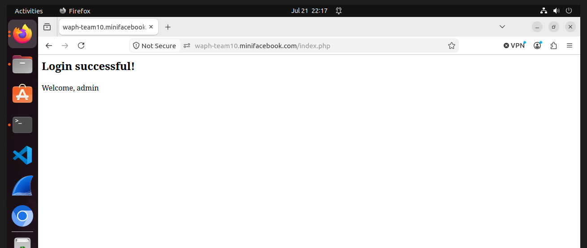

**Local Domain Setup For Each Member**

**Corey Brunner HTTPS Setup**

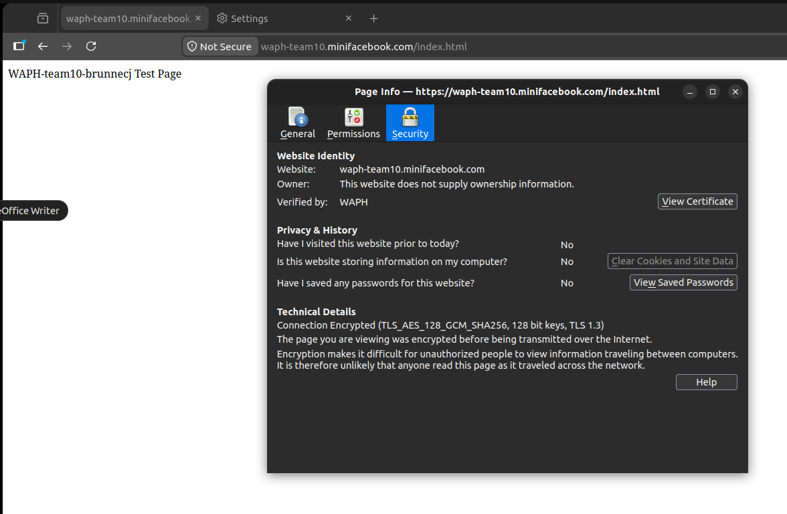

**Bashar Rasras HTTPS Setup**

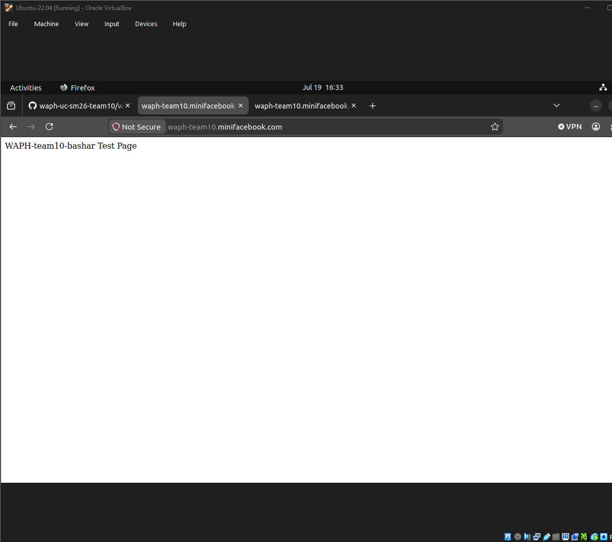

**Pawan Poudyel HTTPS Setup**

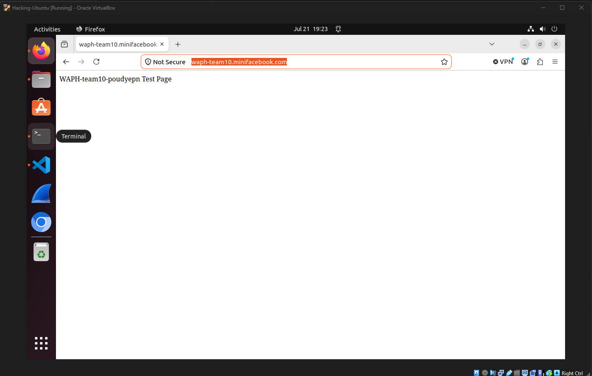

**Mike Wojtkiewicz HTTPS Setup**

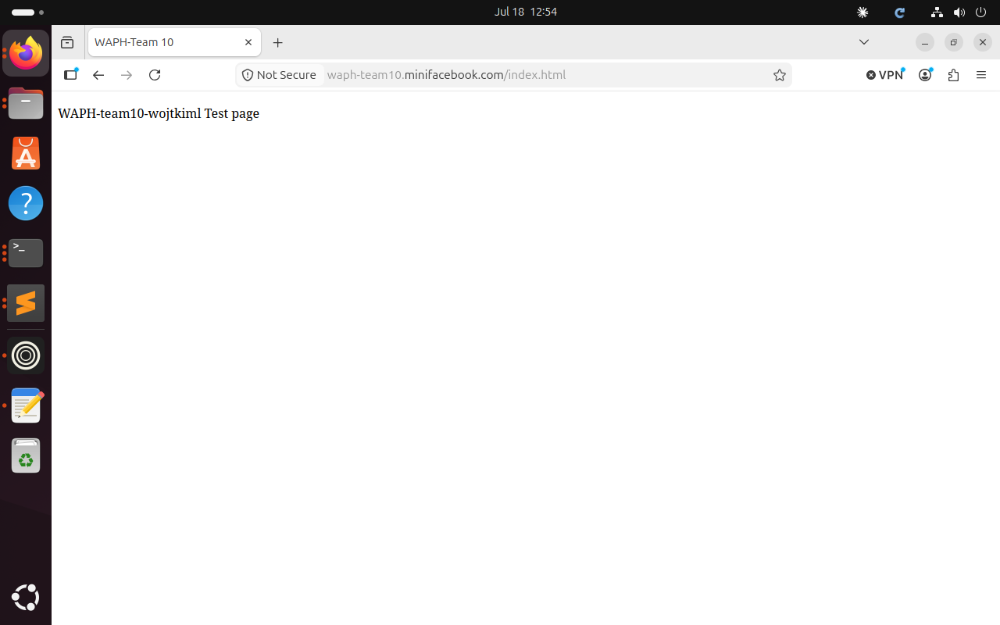

**Successful Local Domain Login Attempt**


_(Start from Sprint 1, keep updating. However, it is important to prepare the technology from Sprint 0)_

For each new sprint cycle, update the implementation of your system and break it down into subsections. Include code snippets to illustrate the implementation.

Specify the team's development approach, including programming languages, databases, development, testing, and deployment environments.

# Security analysis

_Include a brief explanation of your implementation and the security aspects based on the following questions:_

- How did you apply the security programming principles in your project?
- What database security principles have you used in your project?
- Is your code robust and defensive? How?
- How did you defend your code against known attacks such as XSS, SQL Injection, CSRF, and Session Hijacking?
- How do you separate the roles of super users and regular users?

## Sprint 1

**Security programming principles.** Least privilege and no secrets in code. PHP connects with a dedicated MySQL account scoped to this database only, with its password in a git-ignored `.env` outside the web root. A missing setting makes `env()` log the problem and return a generic `Configuration error.` rather than connecting with a blank password.

**Database security.** Every statement in `database.php` is a prepared statement with bound parameters; no input is concatenated into SQL. Passwords are stored as `md5()` hashes, never plaintext. A foreign key from `posts.owner` to `users.userid` enforces referential integrity, and `username` and `email` carry UNIQUE constraints so duplicates are rejected by the database, not only by the application.

**Robust and defensive programming.** Database errors are caught, logged with `error_log()`, and shown to the user as a generic message. Earlier versions echoed raw MySQL exceptions and dumped `$_POST`, including plaintext passwords, to the page, but this behavior was removed. Required fields are validated in both the front-end and back-end. Requests that are missing required information or contain invalid CSRF tokens are rejected before database operations are performed.

**Defenses against known attacks:**

| Attack | Status in Sprint 1 |
|---|---|
| SQL Injection | **Defended** - prepared statements are used throughout the database layer. |
| XSS | **Defended on output** - rendered values pass through `htmlentities(..., ENT_QUOTES, 'UTF-8')`. |
| Session Hijacking | **Partial** - the application is deployed over HTTPS and protected pages require an authenticated session. Additional cookie flags and `session_regenerate_id()` can be added later. |
| CSRF | **Defended for Sprint 1 forms** - registration, password changes, and account-information updates use random session tokens that are validated with `hash_equals()`. Missing or modified tokens receive HTTP status `403`. |
| Credential Exposure | **Defended** - database and admin credentials are stored in a git-ignored `.env` outside the web root. |

**Super users vs regular users.** Not yet implemented - Sprint 1 has one authenticated-user role. A future sprint will add a superuser role with separate administrative pages and session authorization.

**Gaps carried into Sprint 2:** CSP headers, session-cookie hardening, role-based access control, superuser functionality, post creation and deletion, comments, and real-time chat.

# Demo (screenshots)

_You need to capture screenshots to demonstrate how your web application works. The screenshots must be accompanied by a short description of its functionalities following the implementation as below:_

- Everyone can register a new account and then login.
- Superuser can disable an account.
  - The disabled account cannot log in.
  - Superuser can enable the disabled account.
  - The enabled user can log in.
- A regular logged-in user can delete her own existing posts but cannot delete the posts of others.
- CSRF attack to delete a post should be detected and prevented.
- A regular logged-in user cannot access the link for superusers.
- A logged-in user can have a real-time chat with other logged-in users.

## Sprint 1

Demonstrable this sprint:

- Register a new account.
- Log in.
- Access the authenticated homepage.
- Change a password.
- Edit profile information, including name, email, username, and phone.
- View posts stored in the database.
- Verify that protected forms contain CSRF tokens.
- Verify that missing or modified CSRF tokens are rejected.

The homepage and posts page require an authenticated session. Requesting protected pages while logged out redirects the visitor to the login form.

Superusers, account disabling, post creation/deletion, comments, role-based access control, and real-time chat are not implemented yet and will be demonstrated in later sprints.

### Registration

A visitor can open the registration page and create a new user account.

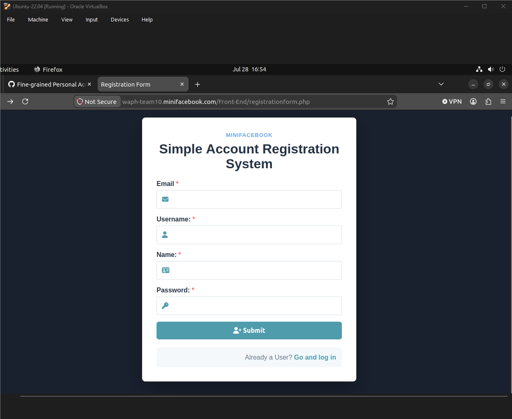

### Successful Login

A registered user can submit valid credentials and log in.


### Authenticated Homepage

After logging in, the user can access the application homepage and navigate to the Sprint 1 features.

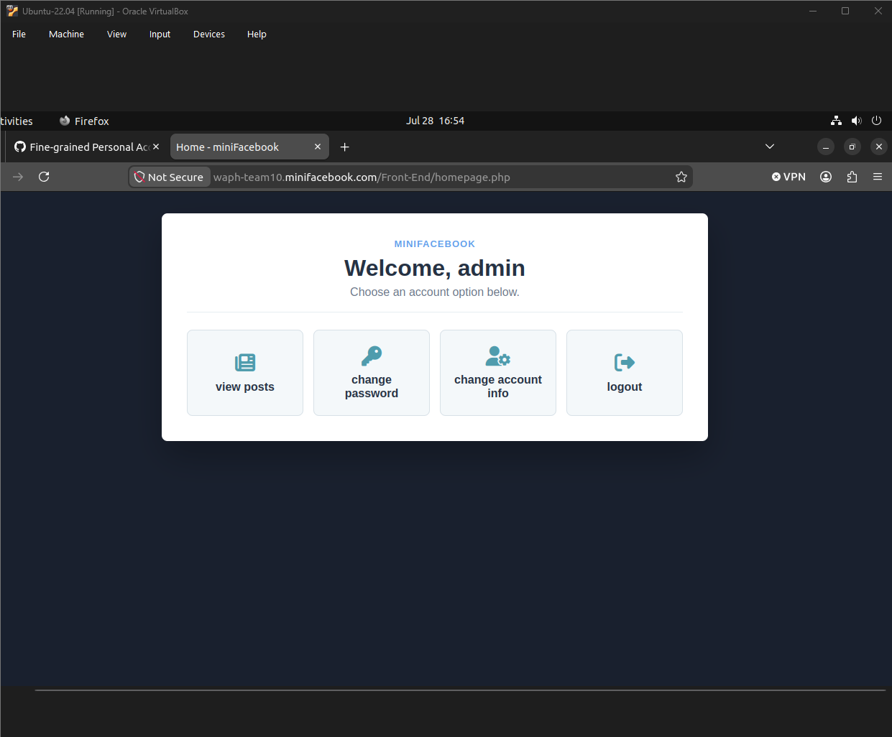

### Change Password

A logged-in user can provide the old password and select a new valid password.

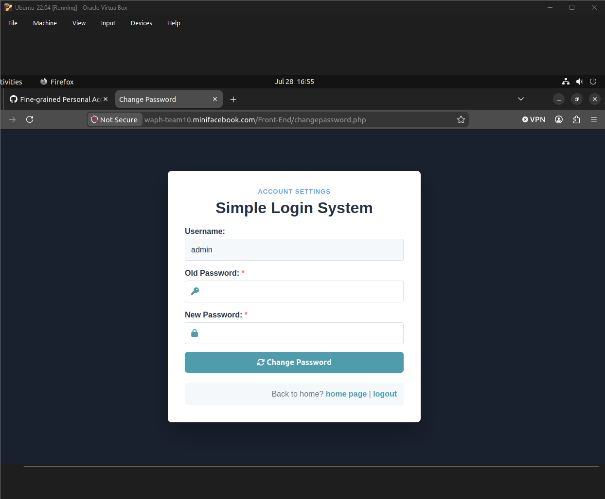

### Change Account Information

A logged-in user can edit the email, username, name, and phone number associated with the account.

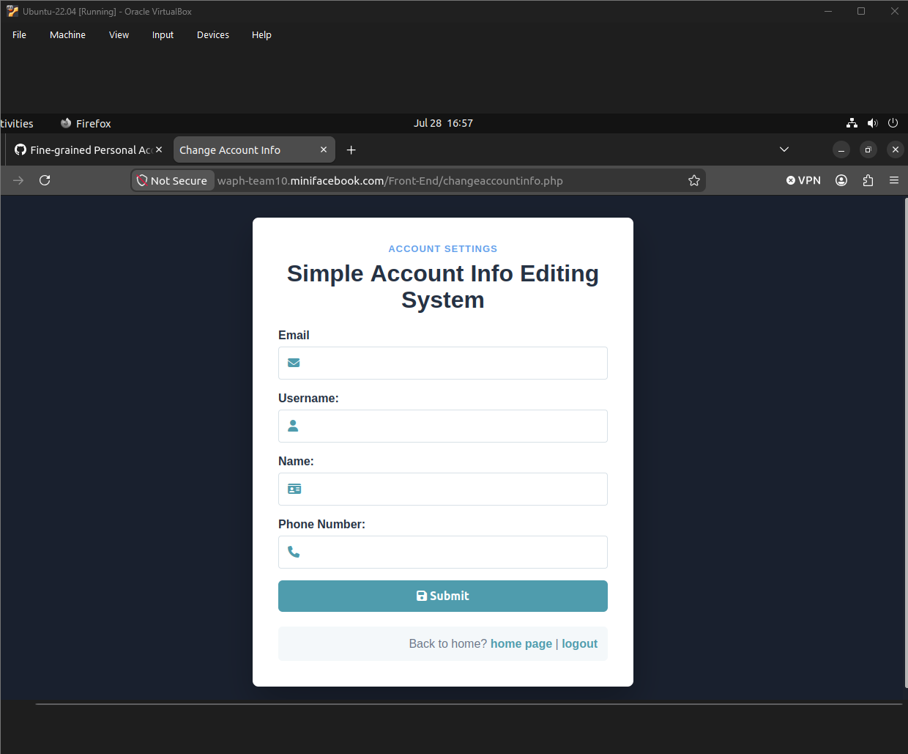

### View Posts

A logged-in user can view posts retrieved from the MySQL `posts` table.

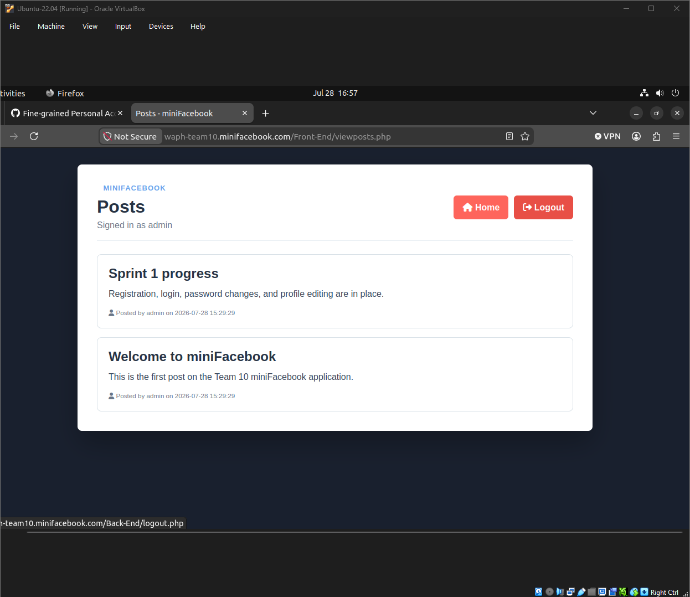

### CSRF Token Included in the Form

The browser inspector demonstrates that the protected form contains a hidden `csrf_token` field.

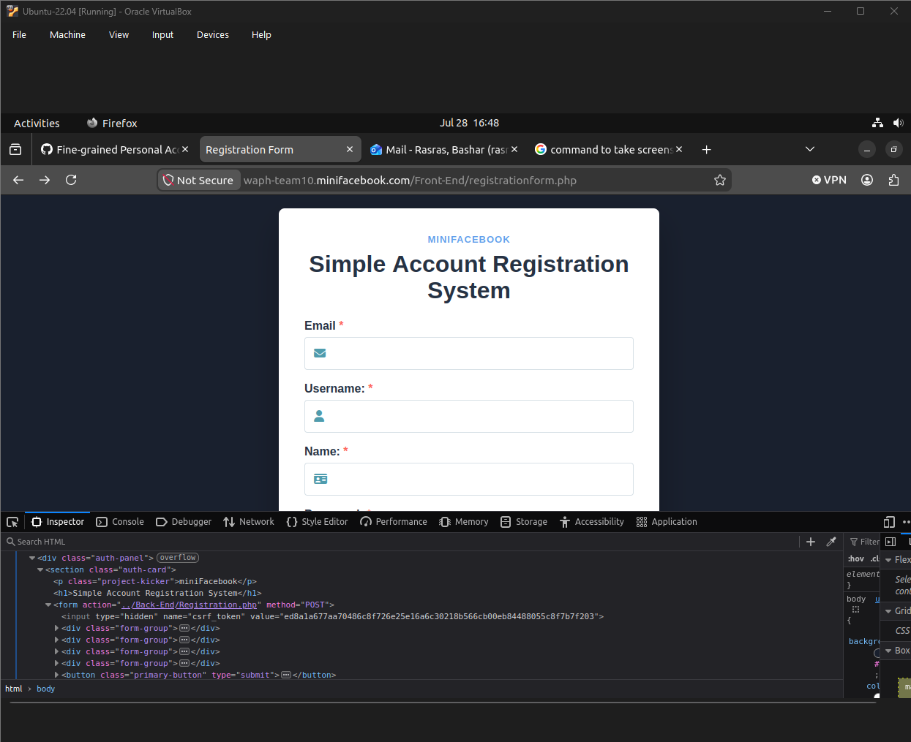

### Invalid CSRF Token Rejected

The hidden CSRF token was manually changed before the form was submitted. The application rejected the request before modifying the database.

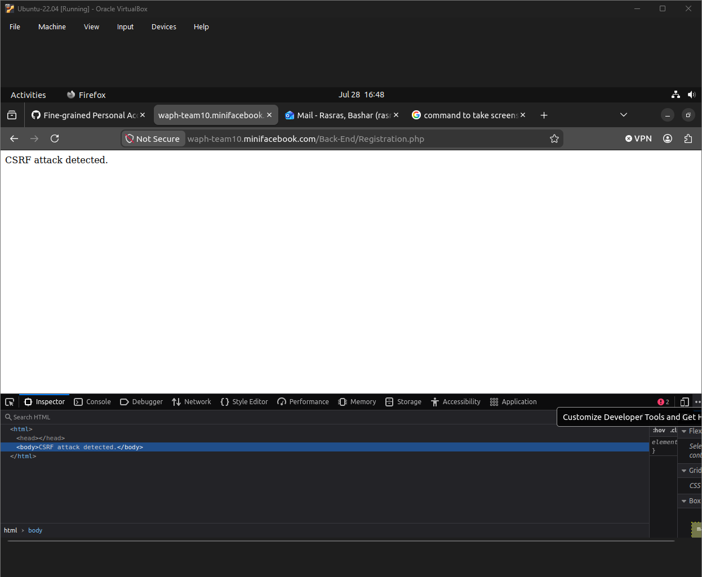

### Users and Posts Database Schemas

The following screenshot contains the outputs of:

```sql
DESCRIBE users;
DESCRIBE posts;
```

The first table describes the schema used to store users' information. The second table describes the schema used to store posts' information.

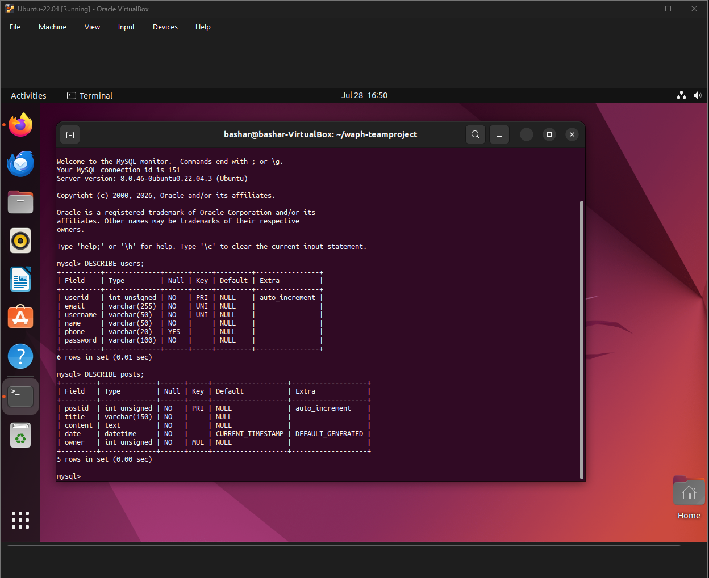

# Software Process Management

_(Start from Sprint 0, keep updating)_

The team follows a Scrum-inspired process. Team members divide tasks, communicate through Discord, commit their work to the shared GitHub repository, deploy and test the application in their individual Ubuntu environments, and document completed work in the README.

## Scrum process

### Sprint 0

Duration: 09/07/2026-21/07/2026

#### Completed Tasks

1. Create Database Schema.
2. Create SSL keys.
3. Host Web server over HTTPS and custom domain.

#### Contributions

1. Corey Brunner, 7 commits, 4.5 hours, contributed by including a custom domain screenshot inside the README and completing individual tasks.
2. Member 2, x commits, y hours, contributed in xxx.
3. Member 3, x commits, y hours, contributed in xxx.
4. Member 4, x commits, y hours, contributed in xxx.

### Sprint 1

Duration: 07/14/2026-07/28/2026

#### Completed Tasks

Sprint 1 required tasks:

1. Database design and implementation for the `users` and `posts` tables.
2. User registration and login.
3. Logged-in users can change their password.
4. Logged-in users can edit their profile, including name, additional email, username, and phone.
5. Logged-in users can view posts from the database.

Supporting and security tasks:

6. Added client-side and server-side input validation.
7. Integrated a shared CSS template for the application interface.
8. Implemented CSRF protection for registration.
9. Implemented CSRF protection for password changes.
10. Implemented CSRF protection for profile-information changes.
11. Tested valid CSRF tokens.
12. Tested modified and missing CSRF tokens.
13. Updated the README and project documentation.
14. Captured and uploaded Sprint 1 demonstration screenshots.
15. Moved credentials into a git-ignored `.env`.
16. Purged the committed private key and database password from Git history.
17. Rotated the TLS certificate.
18. Deployed the application over HTTPS with only `src/` inside the web root.

#### Contributions

1. Corey Brunner, 6 commits, 9 hours, contributed in Created file structure to store files either in Front-End, Back-End, Database schema, and updated readme. Implemented basic code to allow users to sign on, create accounts, and manage accounts.

2. Member 2 - Mike Wojtkiewicz, 6 commits, 3 hours, contributed by moving all secrets to a git-ignored `.env` and purged the committed TLS key and database password from the git history; fixed the broken `ALTER TABLE` and rewrote `schema.sql` with the new `posts` table and a surrogate `userid` primary key; added `GetAllPosts()`, `viewposts.php`, `session_auth.php` and `index.php`; fixed a password change that reported success on a wrong old password, and a profile edit that rejected the user's own username; removed debug output that leaked plaintext passwords and SQL errors; deployed to Apache over HTTPS.

3. Bashar Rasras, 2 commits, 4 hours, contributed by implementing and testing CSRF protection for registration, password changes, and profile-information changes; deploying the updated application; testing valid, modified, and missing CSRF tokens; troubleshooting the account-information and password-change forms; capturing Sprint 1 testing evidence; and updating the Sprint 1 report.

4. Pawan Poudyel, 6 commits, 4 hours ,  contributed by implmenting the input validation for passwords, and implemented the UI for all pages using a template

#### Sprint Retrospection

| Good | Could have been better | How to improve? |
|---|---|---|
| Team members divided the database, authentication, interface, security, deployment, testing, and documentation work. | Some tasks and security requirements were assigned late in the sprint. | Assign each requirement and owner at the beginning of the sprint. |
| Discord communication allowed team members to report progress, repository changes, and blockers. | Communication and meeting times were not always coordinated. | Establish a shared weekly time where everyone joins a call and discusses current work. |
| Registration, login, password changes, profile editing, and viewing posts were completed. | The application entry point and deployment procedure were initially unclear. | Document the application structure and deployment steps before beginning feature development. |
| Input validation, CSS styling, and CSRF protection were completed and tested. | Some form changes caused layout and token-matching problems that required repeated troubleshooting. | Test each form locally immediately after making a change and before committing it. |
| Sensitive credentials were removed from the repository and moved into `.env`. | Sensitive files had been committed during an earlier version of the project. | Review `.gitignore` and secret-management rules before the first commit of each sprint. |
| Modified and missing CSRF tokens were successfully rejected. | Screenshots and README documentation were completed near the end of the sprint. | Capture screenshots and update documentation whenever each feature is completed. |

### Sprint x

Duration: MM/DD/YYYY-MM/DD/YYYY

#### Completed Tasks

1. Task 1
2. Task 2
3. ...
4. Task 4

#### Contributions

1. Member 1, x commits, y hours, contributed in xxx.
2. Member 2, x commits, y hours, contributed in xxx.
3. Member 3, x commits, y hours, contributed in xxx.
4. Member 4, x commits, y hours, contributed in xxx.

#### Sprint Retrospection

| Good | Could have been better | How to improve? |
|---|---|---|
| | | |

# Appendix

Include the content, in text rather than images, of the SQL files and all source code of the PHP files, with the file name.
