## WAPH-Web Application Programming and Hacking

### Instructor: Dr. Phu Phung

# Team 10 Project

## Project Topic/Title - Mini Facebook Web App

# Team members

1. Member 1 - Corey Brunner, email: brunnecj@mail.uc.edu
2. Member 2 - Mike Wojtkiewicz, email: wojtkiml@mail.uc.edu
3. Member 3 - Bashar Rasras, email: rasrasbr@mail.uc.edu
4. Member 4 - Pawan Poudyel, email: poudyepn@mail.uc.edu

# Project Management Information

Source code repository (private access): [https://github.com/waph-uc-sm26-team10/waph-teamproject](https://github.com/waph-uc-sm26-team10/waph-teamproject)

Project homepage (public): [homepage](https://waph-uc-sm26-team10.github.io/)

## Revision History

| Date       | Version | Description |
|------------|:-------:|-------------|
| 07/09/2026 | 0.0 | README Implementation |
| 07/18/2026 | 0.0 | Add SSL and Database setup |
| 07/26/2026 | 0.1 | Implement basic functional requirements such as login, registration, and account management |
| 07/27/2026 | 0.2 | Add posts table and view-posts page, move all secrets to a git-ignored `.env`, deploy over HTTPS |
| 07/28/2026 | 0.3 | Add input validation, CSS interface, CSRF protection, Sprint 1 testing screenshots, contributions, and retrospection |
| 08/05/2026 | 1.0 | Complete posts/comments, superuser administration, role-based access control, real-time chat, and final documentation |

# Overview

The goal of this team project is to build a mini facebook application that takes into account security and full-stack web development.

The completed application allows people to register and active users to log in, manage their profiles/passwords, create posts, edit/delete their posts, comment on posts, and chat in real time.Superusers can view registered accounts and disable or enable them through a protected administration dashboard.

A monolithic LAMP stack: Apache 2.4 over HTTPS, PHP 8.3, and MySQL. The code under `src/` is split into three layers - `Front-End/` (HTML pages and forms), `Back-End/` (request handling and session checks), and `Back-End/database.php`
(all SQL, prepared statements only). `src/config/` holds configuration: `env.php` reads the git-ignored `.env`, `config.php` turns it into constants. No credentials appear in the source.

# System Analysis

Create a full stack web application that creates, edits, and manages users. The application in sprint one should allow the user to create an account, manage that account, and login into the web app. Sprint 1 should account for viewing user posts. Sprint 2 lets users comment on posts, have real time chats, and lets superusers manage other accounts.

## High-level Requirements

Users can log in to a system, change passwords, edit their profile credentials, make and edit those posts, and view comments.

There should be super users that can access the database directly, disable/enable and delete users.

Logged in users can have real time chat messages with other logged in users.

# System Design


## Use-Case Realization

The use cases implemented in Sprint 1, and the files that realize each one:

| Use case | Front-end | Back-end | Data layer function |
|---|---|---|---|
| Register a new account | `Front-End/​registration​form.php` | `Back-End/​Registration.php` | `Register​User()`, `Find​User()` |
| Log in | `Front-End/​login​form.php` | `Back-End/​Login​User.php` | `Login​User()` |
| Change password | `Front-End/​change​password.php` | `Back-End/​Change​Password.php` | `Change​Password()` |
| Edit profile (name, email, phone) | `Front-End/​change​account​info.php` | `Back-End/​Change​Account​Info.php` | `Update​User()` |
| View posts | `Front-End/​view​posts.php` | `Back-End/​session_​auth.php` | `Get​All​Posts()` |
| Create a post | `Front-End/newpost.php` | `Back-End/AddNewPost.php` | `AddPost()` |
| Edit/delete own post | `Front-End/editpost.php`, `Front-End/viewposts.php` | `Back-End/EditPost.php`, `Back-End/DeletePost.php` | `UpdatePost()`, `DeletePost()` |
| Add/view comments | `Front-End/viewposts.php` | `Back-End/AddComment.php` | `AddComment()`, `GetCommentsForPost()` |
| Manage registered users | `Admin/dashboard.php` | `Back-End/superuser_auth.php`, `Back-End/ToggleUser.php` | `GetAllUsers()`, `SetUserDisabled()` |
| Real-time chat | `Front-End/publicchat.php` | `Back-End/session_auth.php`, `Back-End/socketio-chatserver.js` | Socket.IO message/typing events |

`src/index.php` is the entry point. It reads the session and routes visitors to
`Front-End/homepage.php` if they are logged in, or `Front-End/loginform.php` if not.

## Database

Database schema: [https://github.com/waph-uc-sm26-team10/waph-teamproject/blob/main/database/schema.sql](https://github.com/waph-uc-sm26-team10/waph-teamproject/blob/main/database/schema.sql)

The database contains 4 tables (first 2 from Sprint 1):

- **`users`** - `userid` (PK, auto-increment), `email` (unique), `username` (unique), `name`, `phone`, `password` (md5)
- **`posts`** - `postid` (PK, auto-increment), `title`, `content`, `date`, `owner` (FK → `users.userid`)
- **`comments`** - `commentid` (PK, auto-increment), `postid` (FK → `posts.postid`), `owner` (FK → `users.userid`), `content`, `date`
- **`superusers`** - `superuserid` (PK, auto-increment), `userid` (unique FK → `users.userid`)

`userid` is a surrogate key. Usernames are editable on the account page, so using
one as the primary key would mean every rename had to cascade into every table
referencing that user. `userid` never changes; `username` and `email` are kept
UNIQUE so neither can be duplicated. The foreign key is `ON DELETE CASCADE`, so
deleting a user removes their posts.

The same cascade design removes a user's comments and superuser assignment, and deleting a post removes its comments. The `users.disabled` flag preserves the account while preventing login.

<!-- SCREENSHOT-->

All tables and their relations
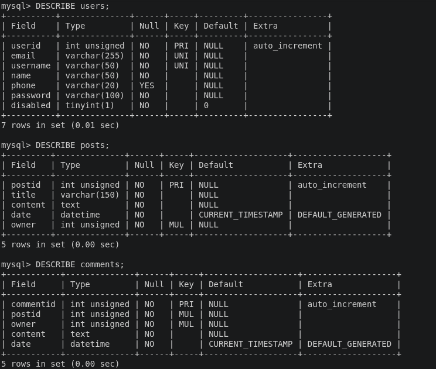  

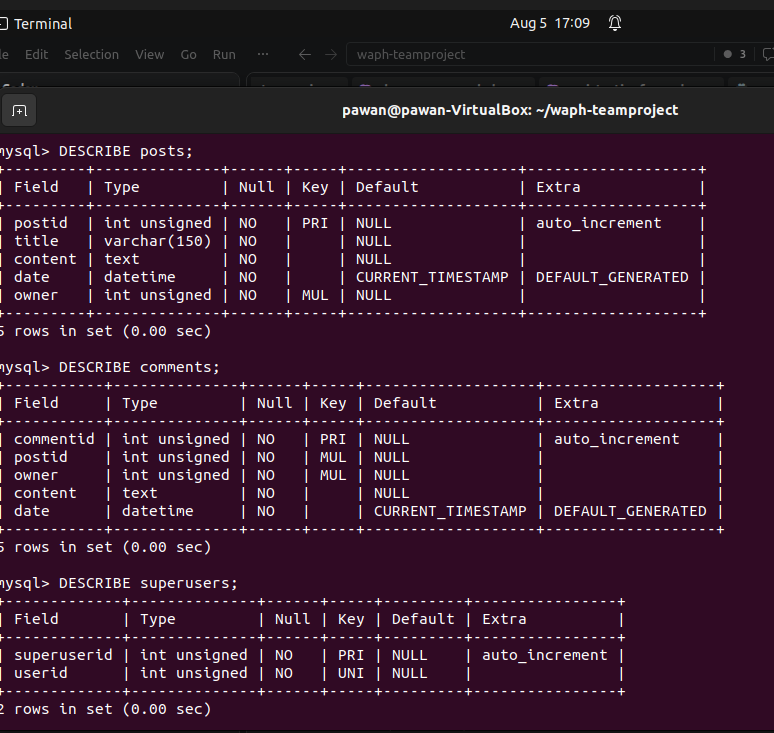  

## User Interface

[Click here to see front end/UI code](/src/Front-End)

The same open-source CSS template, shared `ui.css`, and Font Awesome assets are used across the account, post, chat, and administration interfaces.

# Implementation

A monolithic application that interacts with a database, the server, and the front-end side code. In Sprint 1 it is broken down into four main tasks:

- Interact with users table
  - Logging in
  - Registration
  - Account management
- Create a posts table and allow users to view posts

## Sprint 1 implementation notes

**Configuration.** Credentials live in a git-ignored `.env` read by `src/config/env.php`. The earlier `config.ini` and the committed `database-account.sql` password are gone; the private key committed during Sprint 0 was purged from the Git history and the certificate rotated.

**Displaying posts.** `GetAllPosts()` uses the prepared-statement pattern from Lecture 20 - prepare, execute, bind results, fetch:

```php
$stmt = $mysqli->prepare("SELECT p.postid, p.title, p.content, p.date, u.username
                          FROM posts p JOIN users u ON p.owner = u.userid
                          ORDER BY p.date DESC, p.postid DESC");
$stmt->execute();
$stmt->bind_result($postid, $title, $content, $date, $owner);
while ($stmt->fetch()) {
    $posts[] = ['title' => $title, /* ... */];
}
```

Values are encoded on output, so a post containing markup is displayed, not executed:

```php
<h3><?php echo htmlentities($post['title'], ENT_QUOTES, 'UTF-8'); ?></h3>
```

**Access control.** `src/Back-End/session_auth.php` is included by pages requiring a login and redirects to the login form when no authenticated session exists.

**Input validation.** Required values are validated by the browser and checked again in PHP. Username, email, password, and profile fields use required attributes, patterns, length checks, or server-side validation before database functions are called.

**CSS interface.** The Sprint 1 forms and authenticated pages use the shared CSS interface to provide a consistent layout for registration, login, password management, profile editing, the homepage, and viewing posts.

## CSRF Protection

CSRF protection is implemented for the following Sprint 1 forms:

- Registration
- Change password
- Change account information

When a protected form loads, PHP creates a random token and stores it in the session:

```php
if (empty($_SESSION["account_info_csrf_token"])) {
    $_SESSION["account_info_csrf_token"] =
        bin2hex(random_bytes(32));
}
```

The token is included inside the form as a hidden input:

```php
<input
    type="hidden"
    name="csrf_token"
    value="<?php
        echo htmlentities(
            $_SESSION["account_info_csrf_token"],
            ENT_QUOTES,
            "UTF-8"
        );
    ?>"
>
```

The back-end handler verifies the submitted token before processing the requested database operation:

```php
$submittedToken = $_POST["csrf_token"] ?? "";

if (
    empty($_SESSION["account_info_csrf_token"]) ||
    empty($submittedToken) ||
    !hash_equals(
        $_SESSION["account_info_csrf_token"],
        $submittedToken
    )
) {
    http_response_code(403);
    exit("CSRF Attack Detected");
}
```

If the token is missing, modified, or does not match the session token, the request is rejected with HTTP status `403`.

After a successful request, the token is removed:

```php
unset($_SESSION["account_info_csrf_token"]);
```

## Sprint 2/3 implementation notes

**Posts and comments.** Logged in users can create posts and comment on any posts. Edit and delete controls can only be used by the owner. Ownership is also enforced in the database operation by requiring both the submitted post ID and the authenticated `userid` so changing a URL or hidden form value cannot authorize a user to modify another user's post.

```php
$stmt = $mysqli->prepare(
    "UPDATE posts SET title = ?, content = ? WHERE postid = ? AND owner = ?"
);
$stmt->bind_param("ssii", $title, $content, $postid, $userid);
```

**Superusers.** The `superusers` table has roles assigned directly in the database. After login, the role is stored in the server-side session. `superuser_auth.php` protects the admin dashboard and account management handlers. Superusers can list accounts and disable/enable other users.

**Real-time chat.** `socketio-chatserver.js` broadcasts messages and the typing indicator to connected users. `publicchat.php` requires an authenticated PHP session. Received chat data is inserted using DOM `textContent` to prevent a message being read as html.

**Final CSRF coverage.** actions include random session tokens validated using `hash_equals()` before the requested change occurs.

<!-- SCREENSHOT-->

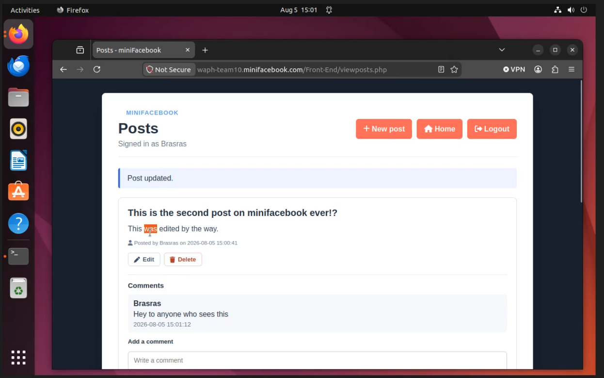  

<!--SCREENSHOT-->

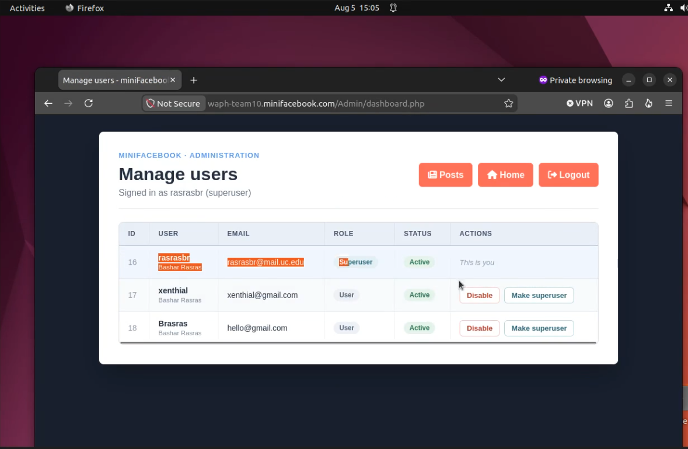  

<!--SCREENSHOT-->

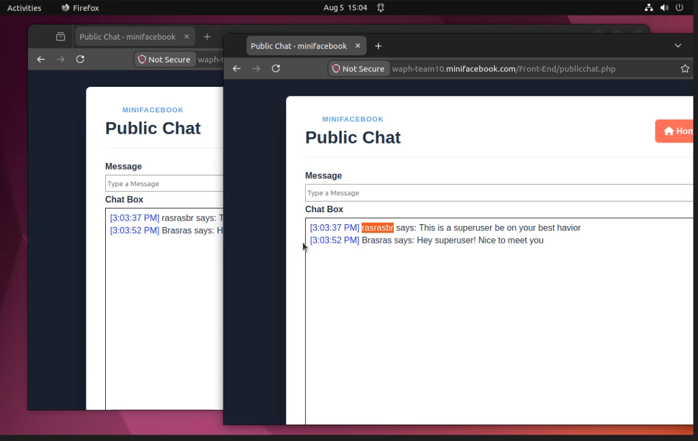  

## Deployment

Served by Apache over HTTPS at `https://waph-team10.minifacebook.com/`. Only the contents of `src/` go into the web root, so the schema, SSL folder and README are never web-reachable. `.env` is placed one directory *above* the web root - readable by PHP, not servable by Apache:

```bash
sudo rsync -a --delete ~/waph-teamproject/src/ /var/www/waph-teamproject/
sudo install -m 640 -o root -g www-data ~/waph-teamproject/.env /var/www/.env
```

## Local Setup

**Secrets** are kept out of the repo via a git-ignored `.env` file. Copy the template and fill in real values:

```bash
cp .env.example .env
```

Then edit `.env` with the required credentials.

**Database** - run the setup script, which reads `.env`, creates the database and application user, creates the tables, and seeds the admin account:

```bash
./database/setup.sh
```

**SSL** - generate a self-signed certificate and key and install them:

```bash
cd sslkey && ./ssl-keygen.sh
```

**Login screenshot example**


**Local Domain Setup For Each Member**

**Corey Brunner HTTPS Setup**


**Bashar Rasras HTTPS Setup**


**Pawan Poudyel HTTPS Setup**


**Mike Wojtkiewicz HTTPS Setup**


**Successful Local Domain Login Attempt**


_(Start from Sprint 1, keep updating. However, it is important to prepare the technology from Sprint 0)_

For each new sprint cycle, update the implementation of your system and break it down into subsections. Include code snippets to illustrate the implementation.

Specify the team's development approach, including programming languages, databases, development, testing, and deployment environments.

# Security analysis

_Include a brief explanation of your implementation and the security aspects based on the following questions:_

- How did you apply the security programming principles in your project?
- What database security principles have you used in your project?
- Is your code robust and defensive? How?
- How did you defend your code against known attacks such as XSS, SQL Injection, CSRF, and Session Hijacking?
- How do you separate the roles of super users and regular users?

## Sprint 1

**Security programming principles.** Least privilege and no secrets in code. PHP connects with a dedicated MySQL account scoped to this database only, with its password in a git-ignored `.env` outside the web root. A missing setting makes `env()` log the problem and return a generic `Configuration error.` rather than connecting with a blank password.

**Database security.** Every statement in `database.php` is a prepared statement with bound parameters; no input is concatenated into SQL. Passwords are stored as `md5()` hashes, never plaintext. A foreign key from `posts.owner` to `users.userid` enforces referential integrity, and `username` and `email` carry UNIQUE constraints so duplicates are rejected by the database, not only by the application.

**Robust and defensive programming.** Database errors are caught, logged with `error_log()`, and shown to the user as a generic message. Earlier versions echoed raw MySQL exceptions and dumped `$_POST`, including plaintext passwords, to the page, but this behavior was removed. Required fields are validated in both the front-end and back-end. Requests that are missing required information or contain invalid CSRF tokens are rejected before database operations are performed.

**Defenses against known attacks:**

| Attack | Status in Sprint 1 |
|---|---|
| SQL Injection | **Defended** - prepared statements are used throughout the database layer. |
| XSS | **Defended on output** - rendered values pass through `htmlentities(..., ENT_QUOTES, 'UTF-8')`. |
| Session Hijacking | **Defended** - the application is deployed over HTTPS, protected pages need an authenticated session, and successful login regenerates the session identifier. |
| CSRF | **Defended** - account, post, comment, and administration forms use random session tokens validated with `hash_equals()`. Missing/modified tokens are rejected before database changes. |
| Credential Exposure | **Defended** - database and admin credentials are stored in a git-ignored `.env` outside the web root. |

**Super users vs regular users.** Public registration creates regular accounts and superuser roles are assigned directly in the database and checked by `superuser_auth.php`. Regular users can't access administration pages. Post editing/deletion separately requires the authenticated user to own the target post.

## Sprint 2/3

The final implementation of miniFacebook had more validation, output encoding, session authentication, and CSRF checks to post and administration features. PHP validates required values, lengths, integer identifiers, and requested status values. SQL types, UNIQUE constraints, and foreign keys provide a final validation layer. Post and comment output passes through `htmlentities()`/`htmlspecialchars()`, and chat messages use DOM `textContent` to defend against XSS.

Role-based access control is applied at the page, request-handler, and SQL layers. A regular user can'y enter the admin dashboard, and a user can't update or delete a post unless the authenticated `userid` matches its owner.

<!--SCREENSHOT-->

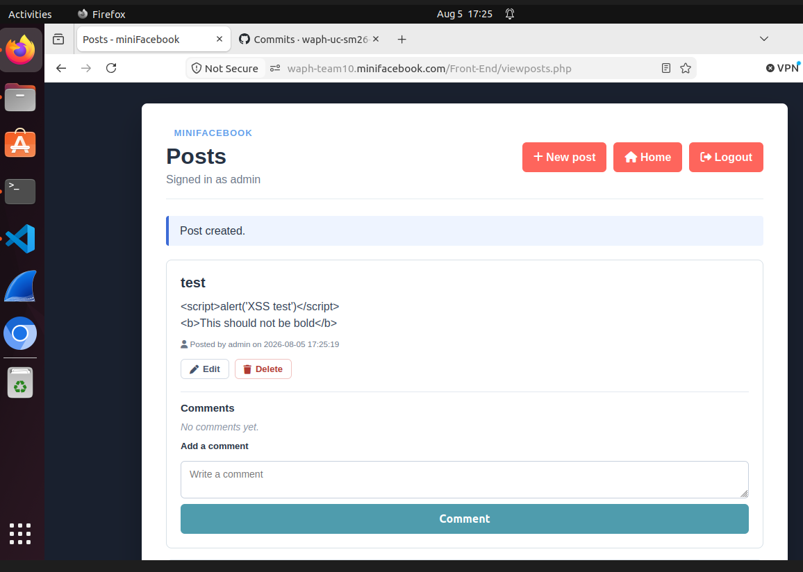  


# Demo (screenshots)

_You need to capture screenshots to demonstrate how your web application works. The screenshots must be accompanied by a short description of its functionalities following the implementation as below:_

- Everyone can register a new account and then login.
- Superuser can disable an account.
  - The disabled account cannot log in.
  - Superuser can enable the disabled account.
  - The enabled user can log in.
- A regular logged-in user can delete her own existing posts but cannot delete the posts of others.
- CSRF attack to delete a post should be detected and prevented.
- A regular logged-in user cannot access the link for superusers.
- A logged-in user can have a real-time chat with other logged-in users.

## Sprint 1

Demonstrable this sprint:

- Register a new account.
- Log in.
- Access the authenticated homepage.
- Change a password.
- Edit profile information, including name, email, username, and phone.
- View posts stored in the database.
- Verify that protected forms contain CSRF tokens.
- Verify that missing or modified CSRF tokens are rejected.

The homepage and posts page require an authenticated session. Requesting protected pages while logged out redirects the visitor to the login form.


### Registration

A visitor can open the registration page and create a new user account.


### Successful Login

A registered user can submit valid credentials and log in.


### Authenticated Homepage

After logging in, the user can access the application homepage and navigate to the Sprint 1 features.


### Change Password

A logged-in user can provide the old password and select a new valid password.


### Change Account Information

A logged-in user can edit the email, username, name, and phone number associated with the account.


### View Posts

A logged-in user can view posts retrieved from the MySQL `posts` table.


### CSRF Token Included in the Form

The browser inspector demonstrates that the protected form contains a hidden `csrf_token` field.


### Invalid CSRF Token Rejected

The hidden CSRF token was manually changed before the form was submitted. The application rejected the request before modifying the database.


### Users and Posts Database Schemas

The following screenshot contains the outputs of:

```sql
DESCRIBE users;
DESCRIBE posts;
```

The first table describes the schema used to store users' information. The second table describes the schema used to store posts' information.


## Sprint 2/3

### Posts and Comments

<!-- SCREENSHOT-->

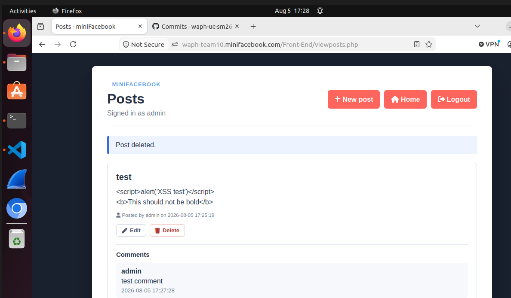  

### Owner-Only Post Management

<!-- SCREENSHOT-->

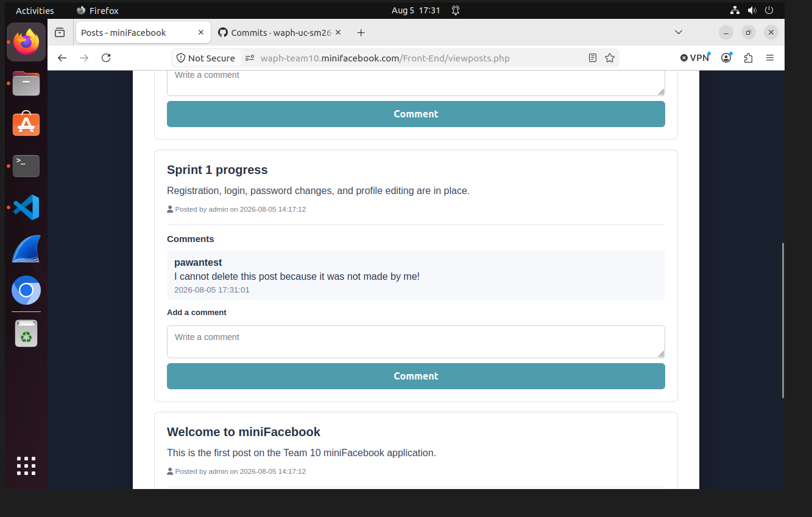  

### Superuser Disable and Enable Workflow

<!--SCREENSHOT -->

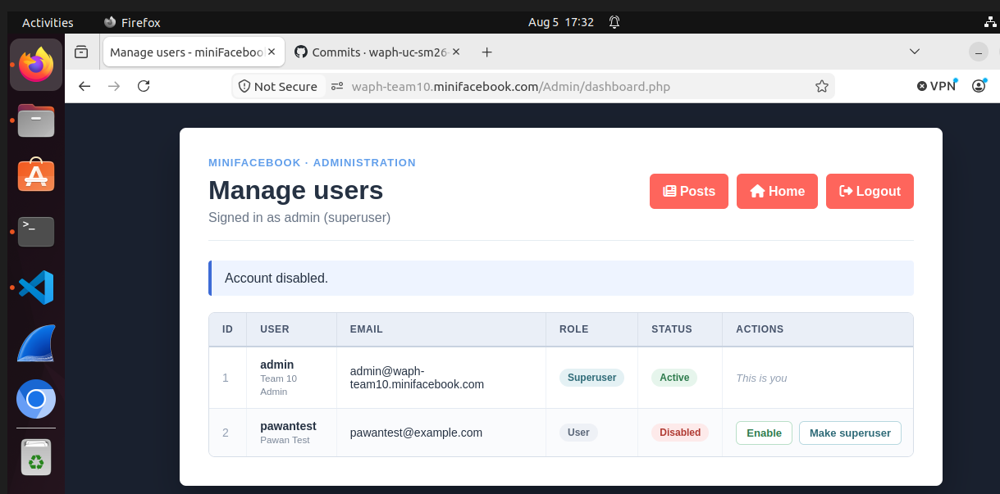  

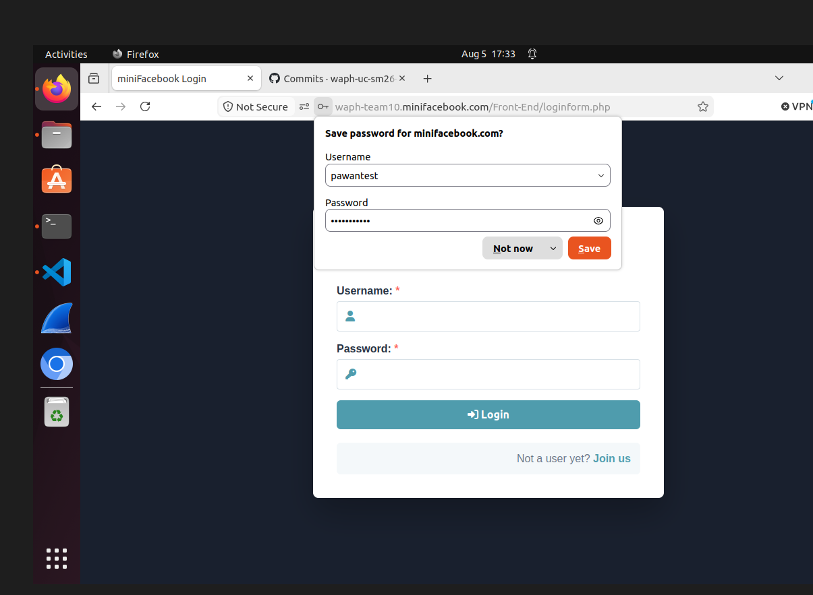  

### CSRF Attack Against Post Deletion

<!--SCREENSHOT-->

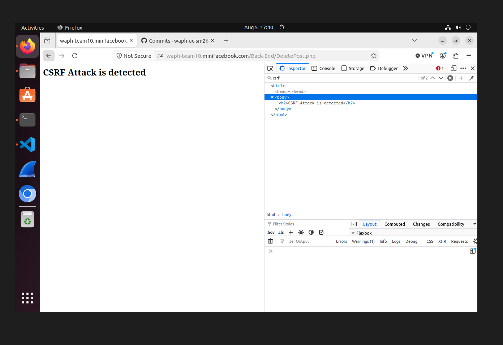  

### Real-Time Chat

<!--SCREENSHOT-->

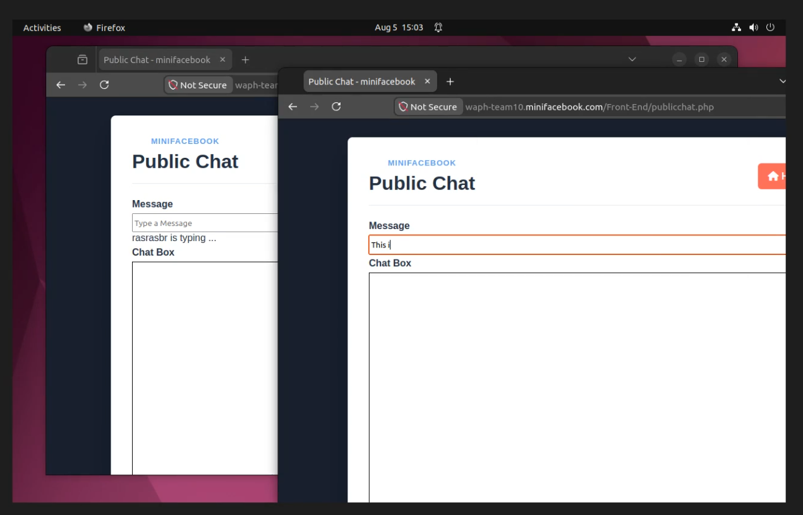  

# Software Process Management

_(Start from Sprint 0, keep updating)_

The team follows a Scrum-inspired process. Team members divide tasks, communicate through Discord, commit their work to the shared GitHub repository, deploy and test the application in their individual Ubuntu environments, and document completed work in the README.

## Scrum process

### Sprint 0

Duration: 09/07/2026-21/07/2026

#### Completed Tasks

1. Create Database Schema.
2. Create SSL keys.
3. Host Web server over HTTPS and custom domain.

#### Contributions

1. Member 1 Corey Brunner, 7 commits, 4.5 hours, contributed by including a custom domain screenshot inside the README and completing individual tasks.
2. Member 2 Mike Wojtkiewicz, 4 commits, 5 hours, contributed by setting up ssl keys and created setup script.
3. Member 3 Bashar Rasras, 4 commits, 4 hours, contributed by updating readme added login system, and screenshots.
4. Member 4 Pawan Poudyel, 4 commits, 4 hours, contributed by updating readme, added screnshots, and fixed issues with .env file.

### Sprint 1

Duration: 07/14/2026-07/28/2026

#### Completed Tasks

Sprint 1 required tasks:

1. Database design and implementation for the `users` and `posts` tables.
2. User registration and login.
3. Logged-in users can change their password.
4. Logged-in users can edit their profile, including name, additional email, username, and phone.
5. Logged-in users can view posts from the database.

Supporting and security tasks:

6. Added client-side and server-side input validation.
7. Integrated a shared CSS template for the application interface.
8. Implemented CSRF protection for registration.
9. Implemented CSRF protection for password changes.
10. Implemented CSRF protection for profile-information changes.
11. Tested valid CSRF tokens.
12. Tested modified and missing CSRF tokens.
13. Updated the README and project documentation.
14. Captured and uploaded Sprint 1 demonstration screenshots.
15. Moved credentials into a git-ignored `.env`.
16. Purged the committed private key and database password from Git history.
17. Rotated the TLS certificate.
18. Deployed the application over HTTPS with only `src/` inside the web root.

#### Contributions

1. Corey Brunner, 6 commits, 9 hours, contributed in Created file structure to store files either in Front-End, Back-End, Database schema, and updated readme. Implemented basic code to allow users to sign on, create accounts, and manage accounts.

2. Member 2 - Mike Wojtkiewicz, 6 commits, 3 hours, contributed by moving all secrets to a git-ignored `.env` and purged the committed TLS key and database password from the git history; fixed the broken `ALTER TABLE` and rewrote `schema.sql` with the new `posts` table and a surrogate `userid` primary key; added `GetAllPosts()`, `viewposts.php`, `session_auth.php` and `index.php`; fixed a password change that reported success on a wrong old password, and a profile edit that rejected the user's own username; removed debug output that leaked plaintext passwords and SQL errors; deployed to Apache over HTTPS.

3. Bashar Rasras, 2 commits, 4 hours, contributed by implementing and testing CSRF protection for registration, password changes, and profile-information changes; deploying the updated application; testing valid, modified, and missing CSRF tokens; troubleshooting the account-information and password-change forms; capturing Sprint 1 testing evidence; and updating the Sprint 1 report.

4. Pawan Poudyel, 6 commits, 4 hours ,  contributed by implmenting the input validation for passwords, and implemented the UI for all pages using a template

#### Sprint Retrospection

| Good | Could have been better | How to improve? |
|---|---|---|
| Team members divided the database, authentication, interface, security, deployment, testing, and documentation work. | Some tasks and security requirements were assigned late in the sprint. | Assign each requirement and owner at the beginning of the sprint. |
| Discord communication allowed team members to report progress, repository changes, and blockers. | Communication and meeting times were not always coordinated. | Establish a shared weekly time where everyone joins a call and discusses current work. |
| Registration, login, password changes, profile editing, and viewing posts were completed. | The application entry point and deployment procedure were initially unclear. | Document the application structure and deployment steps before beginning feature development. |
| Input validation, CSS styling, and CSRF protection were completed and tested. | Some form changes caused layout and token-matching problems that required repeated troubleshooting. | Test each form locally immediately after making a change and before committing it. |
| Sensitive credentials were removed from the repository and moved into `.env`. | Sensitive files had been committed during an earlier version of the project. | Review `.gitignore` and secret-management rules before the first commit of each sprint. |
| Modified and missing CSRF tokens were successfully rejected. | Screenshots and README documentation were completed near the end of the sprint. | Capture screenshots and update documentation whenever each feature is completed. |

### Sprint 2/3

Duration: 07/29/2026-08/05/2026

#### Completed Tasks

1. Added post creation, owner-only editing/deletion, and CSRF protection.
2. Added viewing and posting comments on any existing post.
3. Added the superuser role, protected dashboard, and registered-user list.
4. Added disable/enable account controls and blocked disabled-user login.
5. Added real-time chat and typing notifications with Node.js and Socket.IO.
6. Completed final authorization, CSRF, XSS, session, and deployment testing.

#### Contributions

1. Member 1 Corey Brunner, 6 commits, 7 hours, Updated setup bash script and ssl.conf file to support socket. Implemented Real Time chat, its features ("[username] is typing") and its UI. Handled pull request once the application was stable on "ChatImplementation" branch.
2. Member 2 Mike Wojtkiewicz, 2 commits, 8 hours, contributed in by adding posts/comment updates and CRUD operations. Added superusers and role based access control. Added editing/deleting posts. 
3. Member 3 Bashar Rasras, 3 commits, 6 hours, contributed by creating the final demonstration video and implementing security fixes for the real-time chat feature.
4. Member 4 Pawan Poudyel, 2 commits, 4 hours, contributed by performing final application testing and verification and updating the README for the final submission.

#### Sprint Retrospection

| Good | Could have been better | How to improve? |
|---|---|---|
| Posts, comments, superuser controls, and chat integrated successfully with the Sprint 1 account system. | More planning on whos doing what | Communnication |
| Using bash scripts for easy setup. | More tests before merging. |
| Plan out security testing. |

# Appendix

Include the content, in text rather than images, of the SQL files and all source code of the PHP files, with the file name.


## `database/schema.sql`

````sql
DROP TABLE IF EXISTS `comments`;
DROP TABLE IF EXISTS `posts`;
DROP TABLE IF EXISTS `superusers`;
DROP TABLE IF EXISTS `users`;

CREATE TABLE `users` (
    `userid`   int UNSIGNED NOT NULL AUTO_INCREMENT,
    `email`    varchar(255) NOT NULL,
    `username` varchar(50)  NOT NULL,
    `name`     varchar(50)  NOT NULL,
    `phone`    varchar(20)  DEFAULT NULL,
    `password` varchar(100) NOT NULL,
    `disabled` tinyint(1)   NOT NULL DEFAULT 0,
    PRIMARY KEY (`userid`),
    UNIQUE KEY `uq_users_username` (`username`),
    UNIQUE KEY `uq_users_email` (`email`)
);

CREATE TABLE `superusers` (
    `superuserid` int UNSIGNED NOT NULL AUTO_INCREMENT,
    `userid`      int UNSIGNED NOT NULL,
    PRIMARY KEY (`superuserid`),
    UNIQUE KEY `uq_superusers_userid` (`userid`),
    FOREIGN KEY (`userid`) REFERENCES `users` (`userid`) ON DELETE CASCADE
);

CREATE TABLE `posts` (
    `postid`  int UNSIGNED NOT NULL AUTO_INCREMENT,
    `title`   varchar(150) NOT NULL,
    `content` text         NOT NULL,
    `date`    datetime     NOT NULL DEFAULT CURRENT_TIMESTAMP,
    `owner`   int UNSIGNED NOT NULL,
    PRIMARY KEY (`postid`),
    FOREIGN KEY (`owner`) REFERENCES `users` (`userid`) ON DELETE CASCADE
);

CREATE TABLE `comments` (
    `commentid` int UNSIGNED NOT NULL AUTO_INCREMENT,
    `postid`    int UNSIGNED NOT NULL,
    `owner`     int UNSIGNED NOT NULL,
    `content`   text         NOT NULL,
    `date`      datetime     NOT NULL DEFAULT CURRENT_TIMESTAMP,
    PRIMARY KEY (`commentid`),
    FOREIGN KEY (`postid`) REFERENCES `posts` (`postid`) ON DELETE CASCADE,
    FOREIGN KEY (`owner`)  REFERENCES `users` (`userid`) ON DELETE CASCADE
);

````

## `src/Admin/dashboard.php`

````php
<?php
    require __DIR__ . "/../Back-End/superuser_auth.php";
    require __DIR__ . "/../Back-End/database.php";

    $users = GetAllUsers();

    if (empty($_SESSION["toggle_user_csrf_token"])) {
        $_SESSION["toggle_user_csrf_token"] = bin2hex(random_bytes(32));
    }
    if (empty($_SESSION["toggle_superuser_csrf_token"])) {
        $_SESSION["toggle_superuser_csrf_token"] = bin2hex(random_bytes(32));
    }

    $statusMessage = $_SESSION['StatusMessage'] ?? "";
    unset($_SESSION['StatusMessage']);
?>
<!DOCTYPE html>
<html lang="en">
<head>
    <meta charset="UTF-8">
    <meta name="viewport" content="width=device-width, initial-scale=1.0">
    <title>Manage users - miniFacebook</title>
    <link rel="stylesheet" href="../assets/fontawesome/css/all.min.css">
    <link rel="stylesheet" href="../Front-End/ui.css?v=<?php echo filemtime(__DIR__ . '/../Front-End/ui.css'); ?>">
</head>
<body>
    <main class="page-shell">
        <section class="content-panel">
            <header class="content-header">
                <div>
                    <p class="project-kicker">miniFacebook &middot; administration</p>
                    <h1>Manage users</h1>
                    <p class="account-meta">
                        Signed in as <?php echo htmlentities($_SESSION['username'], ENT_QUOTES, 'UTF-8'); ?> (superuser)
                    </p>
                </div>
                <div class="header-actions">
                    <a class="secondary-button" href="../Front-End/viewposts.php">
                        <i class="fa-solid fa-newspaper"></i>
                        Posts
                    </a>
                    <a class="secondary-button" href="../Front-End/homepage.php">
                        <i class="fa-solid fa-house"></i>
                        Home
                    </a>
                    <a class="secondary-button" href="../Back-End/logout.php">
                        <i class="fa-solid fa-right-from-bracket"></i>
                        Logout
                    </a>
                </div>
            </header>

<?php if ($statusMessage !== ""): ?>
            <p class="status-message"><?php echo htmlentities($statusMessage, ENT_QUOTES, 'UTF-8'); ?></p>
<?php endif; ?>

<?php if (empty($users)): ?>
            <div class="empty-state">No registered users.</div>
<?php else: ?>
            <div class="table-scroll">
            <table class="user-table">
                <thead>
                    <tr>
                        <th>ID</th>
                        <th>User</th>
                        <th>Email</th>
                        <th>Role</th>
                        <th>Status</th>
                        <th>Actions</th>
                    </tr>
                </thead>
                <tbody>
    <?php foreach ($users as $user): ?>
        <?php
            $isDisabled = ((int) $user['disabled'] === 1);
            $isSuper = ((int) $user['is_superuser'] === 1);
            $isSelf = ((int) $user['userid'] === (int) $_SESSION['userid']);
        ?>
                    <tr>
                        <td class="col-id"><?php echo (int) $user['userid']; ?></td>
                        <td class="col-user">
                            <strong><?php echo htmlentities($user['username'], ENT_QUOTES, 'UTF-8'); ?></strong>
                            <small><?php echo htmlentities($user['name'], ENT_QUOTES, 'UTF-8'); ?></small>
                        </td>
                        <td><?php echo htmlentities($user['email'], ENT_QUOTES, 'UTF-8'); ?></td>
                        <td>
                            <span class="badge <?php echo $isSuper ? 'badge-superuser' : 'badge-user'; ?>">
                                <?php echo $isSuper ? 'Superuser' : 'User'; ?>
                            </span>
                        </td>
                        <td>
                            <span class="badge <?php echo $isDisabled ? 'badge-disabled' : 'badge-active'; ?>">
                                <?php echo $isDisabled ? 'Disabled' : 'Active'; ?>
                            </span>
                        </td>
                        <td>
        <?php if ($isSelf): ?>
                            <span class="self-note">This is you</span>
        <?php else: ?>
                            <div class="table-actions">
                            <form action="../Back-End/ToggleUser.php" method="POST" class="inline-form">
                                <input type="hidden" name="userid" value="<?php echo (int) $user['userid']; ?>">
                                <input type="hidden" name="disabled" value="<?php echo $isDisabled ? '0' : '1'; ?>">
                                <input type="hidden" name="csrf_token"
                                       value="<?php echo htmlentities($_SESSION['toggle_user_csrf_token'], ENT_QUOTES, 'UTF-8'); ?>">
                                <button type="submit" class="compact-button <?php echo $isDisabled ? 'is-positive' : 'is-danger'; ?>">
                                    <?php echo $isDisabled ? 'Enable' : 'Disable'; ?>
                                </button>
                            </form>
                            <form action="../Back-End/ToggleSuperuser.php" method="POST" class="inline-form">
                                <input type="hidden" name="userid" value="<?php echo (int) $user['userid']; ?>">
                                <input type="hidden" name="superuser" value="<?php echo $isSuper ? '0' : '1'; ?>">
                                <input type="hidden" name="csrf_token"
                                       value="<?php echo htmlentities($_SESSION['toggle_superuser_csrf_token'], ENT_QUOTES, 'UTF-8'); ?>">
                                <button type="submit" class="compact-button <?php echo $isSuper ? '' : 'is-promote'; ?>">
                                    <?php echo $isSuper ? 'Revoke superuser' : 'Make superuser'; ?>
                                </button>
                            </form>
                            </div>
        <?php endif; ?>
                        </td>
                    </tr>
    <?php endforeach; ?>
                </tbody>
            </table>
            </div>
<?php endif; ?>

        </section>
    </main>
</body>
</html>

````

## `src/Back-End/AddComment.php`

````php
<?php
require __DIR__ . "/session_auth.php";
require __DIR__ . "/database.php";

if ($_SERVER["REQUEST_METHOD"] !== "POST") {
    header("Location: ../Front-End/viewposts.php");
    exit();
}

$submittedToken = $_POST["csrf_token"] ?? "";
if (
    empty($_SESSION["comment_csrf_token"]) ||
    !is_string($submittedToken) ||
    !hash_equals($_SESSION["comment_csrf_token"], $submittedToken)
) {
    echo "<h2>CSRF Attack is detected</h2>";
    die();
}

$postid = filter_input(INPUT_POST, 'postid', FILTER_VALIDATE_INT);
$content = trim($_POST["content"] ?? "");

if ($postid === false || $postid === null) {
    $_SESSION['StatusMessage'] = "That post could not be found.";
    header("Location: ../Front-End/viewposts.php");
    exit();
}

if ($content === "") {
    $_SESSION['StatusMessage'] = "A comment cannot be empty.";
    header("Location: ../Front-End/viewposts.php");
    exit();
}

if (strlen($content) > 1000) {
    $_SESSION['StatusMessage'] = "A comment cannot be longer than 1000 characters.";
    header("Location: ../Front-End/viewposts.php");
    exit();
}

if (GetPost($postid) === null) {
    $_SESSION['StatusMessage'] = "That post could not be found.";
    header("Location: ../Front-End/viewposts.php");
    exit();
}

AddComment($postid, $_SESSION['userid'], $content);
header("Location: ../Front-End/viewposts.php");
exit();

````

## `src/Back-End/AddNewPost.php`

````php
<?php
require __DIR__ . "/session_auth.php";
require __DIR__ . "/database.php";

if ($_SERVER["REQUEST_METHOD"] !== "POST") {
    header("Location: ../Front-End/newpost.php");
    exit();
}

$submittedToken = $_POST["csrf_token"] ?? "";
if (
    empty($_SESSION["newpost_csrf_token"]) ||
    !is_string($submittedToken) ||
    !hash_equals($_SESSION["newpost_csrf_token"], $submittedToken)
) {
    echo "<h2>CSRF Attack is detected</h2>";
    die();
}

$title = trim($_POST["title"] ?? "");
$content = trim($_POST["content"] ?? "");

if ($title === "" || $content === "") {
    $_SESSION['StatusMessage'] = "Title and content cannot be empty.";
    header("Location: ../Front-End/newpost.php");
    exit();
}

if (strlen($title) < 3 || strlen($title) > 150) {
    $_SESSION['StatusMessage'] = "Title must be between 3 and 150 characters.";
    header("Location: ../Front-End/newpost.php");
    exit();
}

if (strlen($content) > 5000) {
    $_SESSION['StatusMessage'] = "Content cannot be longer than 5000 characters.";
    header("Location: ../Front-End/newpost.php");
    exit();
}

if (AddPost($title, $content, $_SESSION['userid'])) {
    unset($_SESSION["newpost_csrf_token"]);
    header("Location: ../Front-End/viewposts.php");
    exit();
}

header("Location: ../Front-End/newpost.php");
exit();

````

## `src/Back-End/ChangeAccountInfo.php`

````php
<?php
session_start();

require __DIR__ . "/database.php";

if ($_SERVER["REQUEST_METHOD"] !== "POST") {
    exit("Please submit the account information form.");
}

$submittedToken = $_POST["csrf_token"] ?? "";

if (
    empty($_SESSION["account_info_csrf_token"]) ||
    empty($submittedToken) ||
    !hash_equals(
        $_SESSION["account_info_csrf_token"],
        $submittedToken
    )
) {
    http_response_code(403);
    exit("CSRF Attack Detected");
}

$email = $_POST["email"] ?? "";
$username = $_POST["username"] ?? "";
$name = $_POST["name"] ?? "";
$phone = $_POST["phone"] ?? "";

if (
    empty($email) &&
    empty($username) &&
    empty($name) &&
    empty($phone)
) {
    echo "<h2>Account update failed.</h2>";
    echo "<p>All fields are empty. Cannot change user information.</p>";
    header("Refresh:2; url=../Front-End/changeaccountinfo.php");
    exit();
}

if (UpdateUser($email, $username, $name, $phone)) {
    unset($_SESSION["account_info_csrf_token"]);

    echo "<h2>Account information updated successfully!</h2>";

    if (!empty($name)) {
        echo "<p>Welcome, " .
            htmlentities($name, ENT_QUOTES, "UTF-8") .
            "</p>";
    }

    header("Refresh:2; url=../Front-End/homepage.php");
    exit();
}

echo "<h2>Account update failed!</h2>";
header("Refresh:2; url=../Front-End/changeaccountinfo.php");
exit();
?>

````

## `src/Back-End/ChangePassword.php`

````php
<?php
session_start();
require __DIR__ . "/database.php";

if ($_SERVER["REQUEST_METHOD"] === "POST") {
    $submittedToken = $_POST["csrf_token"] ?? "";

if (
    empty($_SESSION["change_password_csrf_token"]) ||
    empty($submittedToken) ||
    !hash_equals(
        $_SESSION["change_password_csrf_token"],
        $submittedToken
    )
) {
    http_response_code(403);
    exit("CSRF attack detected.");
}
    $oldPassword = sanitize_input($_POST["oldPassword"] ?? "");
    $newPassword = sanitize_input($_POST["newPassword"] ?? "");

    if (empty($oldPassword) || empty($newPassword)) {
        echo "<h2>Login failed.</h2>";
        echo "<p>Username and password cannot be empty.</p>";
        header("Refresh:0; url=../Front-End/changepassword.php");
        die();
    }

    if (strlen($oldPassword) > 100 || strlen($newPassword) > 100) {
        echo "<h2>Password changed Failed!</h2>";
        echo "<p>Input is too long.</p>";
        header("Refresh:0; url=../Front-End/changepassword.php");
        die();
    }

    if (!preg_match("/^(?=.*\d)(?=.*[a-z])(?=.*[A-Z]).{6,}$/", $newPassword)) {
        echo "<h2>Password changed Failed!</h2>";
        echo "<p>Password must be at least 6 characters and include uppercase, lowercase, and a number.</p>";
        header("Refresh:0; url=../Front-End/changepassword.php");
        die();
    }

    if (ChangePassword($newPassword,$oldPassword)) {
    unset($_SESSION["change_password_csrf_token"]);
        echo "<h2>Password changed successful!</h2>";
        echo "<p>Welcome, " . htmlentities($_SESSION['username'], ENT_QUOTES, 'UTF-8') . "</p>";
        header("Refresh:0; url=../Front-End/homepage.php");
        exit();
    } else {
        echo "<h2>Password changed Failed!</h2>";
        header("Refresh:0; url=../Front-End/changepassword.php");
        die();
    }

} else {
    echo "Please submit the login form.";
}

function sanitize_input($input) {
    $input = trim($input);
    $input = stripslashes($input);
    $input = htmlspecialchars($input);
    return $input;
}
?>

````

## `src/Back-End/DeletePost.php`

````php
<?php
require __DIR__ . "/session_auth.php";
require __DIR__ . "/database.php";

if ($_SERVER["REQUEST_METHOD"] !== "POST") {
    header("Location: ../Front-End/viewposts.php");
    exit();
}

$submittedToken = $_POST["csrf_token"] ?? "";
if (
    empty($_SESSION["post_action_csrf_token"]) ||
    !is_string($submittedToken) ||
    !hash_equals($_SESSION["post_action_csrf_token"], $submittedToken)
) {
    echo "<h2>CSRF Attack is detected</h2>";
    die();
}

$postid = filter_input(INPUT_POST, 'postid', FILTER_VALIDATE_INT);
if ($postid === false || $postid === null) {
    $_SESSION['StatusMessage'] = "That post could not be found.";
    header("Location: ../Front-End/viewposts.php");
    exit();
}

DeletePost($postid, $_SESSION['userid']);
header("Location: ../Front-End/viewposts.php");
exit();

````

## `src/Back-End/EditPost.php`

````php
<?php
require __DIR__ . "/session_auth.php";
require __DIR__ . "/database.php";

if ($_SERVER["REQUEST_METHOD"] !== "POST") {
    header("Location: ../Front-End/viewposts.php");
    exit();
}

$submittedToken = $_POST["csrf_token"] ?? "";
if (
    empty($_SESSION["editpost_csrf_token"]) ||
    !is_string($submittedToken) ||
    !hash_equals($_SESSION["editpost_csrf_token"], $submittedToken)
) {
    echo "<h2>CSRF Attack is detected</h2>";
    die();
}

$postid = filter_input(INPUT_POST, 'postid', FILTER_VALIDATE_INT);
$title = trim($_POST["title"] ?? "");
$content = trim($_POST["content"] ?? "");

if ($postid === false || $postid === null) {
    $_SESSION['StatusMessage'] = "That post could not be found.";
    header("Location: ../Front-End/viewposts.php");
    exit();
}

if ($title === "" || $content === "") {
    $_SESSION['StatusMessage'] = "Title and content cannot be empty.";
    header("Location: ../Front-End/editpost.php?postid=" . $postid);
    exit();
}

if (strlen($title) < 3 || strlen($title) > 150 || strlen($content) > 5000) {
    $_SESSION['StatusMessage'] = "Title must be 3-150 characters and content under 5000.";
    header("Location: ../Front-End/editpost.php?postid=" . $postid);
    exit();
}

UpdatePost($postid, $title, $content, $_SESSION['userid']);
unset($_SESSION["editpost_csrf_token"]);
header("Location: ../Front-End/viewposts.php");
exit();

````

## `src/Back-End/LoginUser.php`

````php
<?php
session_start();
require __DIR__ . "/database.php";

if ($_SERVER["REQUEST_METHOD"] === "POST") {

    $username = $_POST["username"] ?? "";
    $password = $_POST["password"] ?? "";

    if (empty($username) || empty($password)) {
        echo "<h2>Login failed.</h2>";
        echo "<p>Username and password cannot be empty.</p>";
        header("Refresh:0; url=../Front-End/loginform.php");
        die();
    }
    if (LoginUser($username, $password)) {
        echo "<h2>Login successful!</h2>";
        echo "<p>Welcome, " . htmlentities($_SESSION['username'], ENT_QUOTES, 'UTF-8') . "</p>";
        header("Refresh:0; url=../Front-End/homepage.php");
        exit();
    } else {
        header("Refresh:0; url=../Front-End/loginform.php");
        die();
    }

} else {
    echo "Please submit the login form.";
}
?>

````

## `src/Back-End/Registration.php`

````php
<?php
    session_start();
    require __DIR__ . "/database.php";

    if ($_SERVER["REQUEST_METHOD"] === "POST") {
    $submittedToken = $_POST["csrf_token"] ?? "";

    if (
         empty($_SESSION["registration_csrf_token"]) ||
     empty($submittedToken) ||
     !hash_equals(
             $_SESSION["registration_csrf_token"],
             $submittedToken
     )
    ){
     http_response_code(403);
     exit("CSRF attack detected.");
    }
        $email = sanitize_input($_POST["email"] ?? "");
        $username = sanitize_input($_POST["username"] ?? "");
        $name = sanitize_input($_POST["name"] ?? "");
        $password = sanitize_input($_POST["password"] ?? "");

        if (empty($username) || empty($password)) {
            echo "<h2>Registration failed.</h2>";
            echo "<p>Username and password cannot be empty.</p>";
            header("Refresh:0; url=../Front-End/registrationform.php");
            exit();
        }
        if(empty($email) || empty($name)){
            echo "<h2>Registration failed.</h2>";
            echo "<p>email and name cannot be empty.</p>";
            header("Refresh:0; url=../Front-End/registrationform.php");
            exit();
        }

        if (strlen($name) > 50 || strlen($email) > 255 || strlen($username) > 50 || strlen($password) > 100) {
            echo "<h2>Registration failed.</h2>";
            echo "<p>Input is too long.</p>";
            header("Refresh:0; url=../Front-End/registrationform.php");
            exit();
        }

        if (!preg_match("/^\w+$/", $username)) {
            echo "<h2>Registration failed.</h2>";
            echo "<p>Username can contain only letters, numbers, and underscores.</p>";
            header("Refresh:0; url=../Front-End/registrationform.php");
            exit();
        }

        if (!preg_match("/^[a-zA-Z ]*$/", $name)) {
            echo "<h2>Registration failed.</h2>";
            echo "<p>Name can contain only letters and spaces.</p>";
            header("Refresh:0; url=../Front-End/registrationform.php");
            exit();
        }

        if (!preg_match("/^(?=.*\d)(?=.*[a-z])(?=.*[A-Z]).{6,}$/", $password)) {
            echo "<h2>Registration failed.</h2>";
            echo "<p>Password must be at least 6 characters and include uppercase, lowercase, and a number.</p>";
            header("Refresh:0; url=../Front-End/registrationform.php");
            exit();
        }

        if (FindUser($username)) {
            echo "<h2>Registration failed.</h2>";
            echo "<p>Username Already Exists</p>";
            $_SESSION['StatusMessage'] = "Username Already Exists";
            header("Refresh:0; url=../Front-End/registrationform.php");
            exit();
        }

        if (RegisterUser($email,$username,$name,$password)) {
        unset($_SESSION["registration_csrf_token"]);
            echo "<h2>Registration successful!</h2>";
            echo "<p>Welcome, " . htmlentities($name, ENT_QUOTES, 'UTF-8') . "</p>";
            header("Refresh:0; url=../Front-End/loginform.php");
            exit();
        } else {
            echo "<h2>Registration Failed!</h2>";
            header("Refresh:0; url=../Front-End/registrationform.php");
            exit();
        }

    } else {
        echo "Please submit the login form.";
    }

    function sanitize_input($input) {
        $input = trim($input);
        $input = stripslashes($input);
        $input = htmlspecialchars($input);
        return $input;
    }
?>

````

## `src/Back-End/ToggleSuperuser.php`

````php
<?php
require __DIR__ . "/superuser_auth.php";
require __DIR__ . "/database.php";

if ($_SERVER["REQUEST_METHOD"] !== "POST") {
    header("Location: ../Admin/dashboard.php");
    exit();
}

$submittedToken = $_POST["csrf_token"] ?? "";
if (
    empty($_SESSION["toggle_superuser_csrf_token"]) ||
    !is_string($submittedToken) ||
    !hash_equals($_SESSION["toggle_superuser_csrf_token"], $submittedToken)
) {
    echo "<h2>CSRF Attack is detected</h2>";
    die();
}

$userid = filter_input(INPUT_POST, 'userid', FILTER_VALIDATE_INT);
$superuser = filter_input(INPUT_POST, 'superuser', FILTER_VALIDATE_INT);

if ($userid === false || $userid === null || $superuser === false || $superuser === null) {
    $_SESSION['StatusMessage'] = "That account could not be found.";
    header("Location: ../Admin/dashboard.php");
    exit();
}

if ($superuser !== 0 && $superuser !== 1) {
    $_SESSION['StatusMessage'] = "Invalid request.";
    header("Location: ../Admin/dashboard.php");
    exit();
}

if ($userid === (int) $_SESSION['userid']) {
    $_SESSION['StatusMessage'] = "You cannot change your own superuser access.";
    header("Location: ../Admin/dashboard.php");
    exit();
}

SetUserSuperuser($userid, $superuser === 1);
header("Location: ../Admin/dashboard.php");
exit();

````

## `src/Back-End/ToggleUser.php`

````php
<?php
require __DIR__ . "/superuser_auth.php";
require __DIR__ . "/database.php";

if ($_SERVER["REQUEST_METHOD"] !== "POST") {
    header("Location: ../Admin/dashboard.php");
    exit();
}

$submittedToken = $_POST["csrf_token"] ?? "";
if (
    empty($_SESSION["toggle_user_csrf_token"]) ||
    !is_string($submittedToken) ||
    !hash_equals($_SESSION["toggle_user_csrf_token"], $submittedToken)
) {
    echo "<h2>CSRF Attack is detected</h2>";
    die();
}

$userid = filter_input(INPUT_POST, 'userid', FILTER_VALIDATE_INT);
$disabled = filter_input(INPUT_POST, 'disabled', FILTER_VALIDATE_INT);

if ($userid === false || $userid === null || $disabled === false || $disabled === null) {
    $_SESSION['StatusMessage'] = "That account could not be found.";
    header("Location: ../Admin/dashboard.php");
    exit();
}

if ($disabled !== 0 && $disabled !== 1) {
    $_SESSION['StatusMessage'] = "Invalid request.";
    header("Location: ../Admin/dashboard.php");
    exit();
}

if ($userid === (int) $_SESSION['userid']) {
    $_SESSION['StatusMessage'] = "You cannot disable your own account.";
    header("Location: ../Admin/dashboard.php");
    exit();
}

SetUserDisabled($userid, $disabled === 1);
header("Location: ../Admin/dashboard.php");
exit();

````

## `src/Back-End/database.php`

````php
<?php
    if (session_status() !== PHP_SESSION_ACTIVE) {
        session_start();
    }
    require_once __DIR__ . '/../config/config.php';

    $mysqli = new mysqli(DB_HOST, DB_USER, DB_PASSWORD, DB_NAME);

    if ($mysqli->connect_errno) {
        // Log the real reason; show the user nothing that describes our database.
        error_log("WAPH-Team10 database connection failed: " . $mysqli->connect_error);
        die("Database connection failed.");
    }

    function ChangePassword($newPassword, $oldPassword){
        try{
            global $mysqli;
            $preparedsql = "UPDATE users SET password = md5(?) WHERE userid = ? AND password = md5(?)";
            $stmt = $mysqli->prepare($preparedsql);
            if(!$stmt) {
                $_SESSION['StatusMessage'] = "Prepared statement failed.";
                return false;
            }
            $stmt->bind_param("sis", $newPassword, $_SESSION['userid'], $oldPassword );

            if(!$stmt->execute()){
                $_SESSION['StatusMessage'] = "Changed Password Failed";
                return false;
            }
            if($stmt->affected_rows === 1){
                return true;
            }
            $_SESSION['StatusMessage'] = "Current password is incorrect.";
            return false;
        }
        catch(mysqli_sql_exception $e){
            error_log("WAPH-Team10 ChangePassword failed: " . $e->getMessage());
            $_SESSION['StatusMessage'] = "Could not change password. Please try again.";
            return false;
        }
    }

    function LoginUser($username, $password){
        try{
            global $mysqli;
            $preparedsql = "SELECT userid, username, disabled FROM users WHERE username = ? AND password = md5(?)";
            $stmt = $mysqli->prepare($preparedsql);
            if(!$stmt) {
                $_SESSION['StatusMessage'] = "Prepared statement failed.";
                return false;
            }
            $stmt->bind_param("ss", $username, $password);

            $stmt->execute();

            $result = $stmt->get_result();
            if($result->num_rows == 1){
                $row = $result->fetch_assoc();
                if((int) $row['disabled'] === 1){
                    $_SESSION['StatusMessage'] = "This account has been disabled. Please contact an administrator.";
                    return false;
                }
                session_regenerate_id(true);
                $_SESSION['userid'] = (int) $row['userid'];
                $_SESSION['username'] = $row['username'];
                $_SESSION['role'] = IsSuperuser((int) $row['userid']) ? 'superuser' : 'user';
                return true;
            }
            $_SESSION['StatusMessage'] = "Incorrect Username or Password";
            return false;
        }
        catch(mysqli_sql_exception $e){
            error_log("WAPH-Team10 LoginUser failed: " . $e->getMessage());
            $_SESSION['StatusMessage'] = "Login failed. Please try again.";
            return false;
        }
    }
    function FindUser($username){
        try{
            global $mysqli;
            $preparedsql = "SELECT * FROM users where username = ?";
            $stmt = $mysqli->prepare($preparedsql);
            if(!$stmt) {
                $_SESSION['StatusMessage'] = "Prepared statement failed.";
                die();
            }
            $stmt->bind_param("s",$username);
            $stmt->execute();

            if($stmt->get_result()->num_rows == 1){
                return true;
            }
            return false;
        }
        catch(mysqli_sql_exception $e){
            //echo "<p>debug Info>" . $e->getMessage() ."</p>";
            die();
        }
    }
    function RegisterUser($email, $username, $name, $password){
        try{
            global $mysqli;
            $preparedsql = "INSERT INTO users (email, username, name, password) VALUES(?,?,?,md5(?))";
            $stmt = $mysqli->prepare($preparedsql);
            if(!$stmt) {
                $_SESSION['StatusMessage'] = "Prepared statement failed.";
                die();
            }
            $stmt->bind_param("ssss", $email, $username, $name, $password);
            //check if username already exists
            if(FindUser($username)){
                $_SESSION['StatusMessage'] = "Username Already Exists";
                return false;
            }
            if($stmt->execute()){
                $_SESSION['StatusMessage'] = "Account Registered Successfully";
                return true;
            }
            $_SESSION['StatusMessage'] = "Failed to Register User. Please try again!";
            return false;
        }catch(mysqli_sql_exception $e){
            //echo "<p>debug Info>" . $e->getMessage() ."</p>";
            die();
        }
    }

    function UsernameTakenByOther($username, $userid){
        try{
            global $mysqli;
            $preparedsql = "SELECT userid FROM users WHERE username = ? AND userid <> ?";
            $stmt = $mysqli->prepare($preparedsql);
            if(!$stmt) {
                $_SESSION['StatusMessage'] = "Prepared statement failed.";
                return true;
            }
            $stmt->bind_param("si", $username, $userid);
            $stmt->execute();
            return $stmt->get_result()->num_rows > 0;
        }
        catch(mysqli_sql_exception $e){
            error_log("WAPH-Team10 UsernameTakenByOther failed: " . $e->getMessage());
            return true;
        }
    }

    function GetAllPosts(){
        try{
            global $mysqli;
            $preparedsql = "SELECT p.postid, p.title, p.content, p.date, u.username, u.userid
                            FROM posts p
                            JOIN users u ON p.owner = u.userid
                            ORDER BY p.date DESC, p.postid DESC";
            $stmt = $mysqli->prepare($preparedsql);
            if(!$stmt) {
                $_SESSION['StatusMessage'] = "Prepared statement failed.";
                return [];
            }
            if(!$stmt->execute()){
                $_SESSION['StatusMessage'] = "Could not load posts.";
                return [];
            }

            $postid = NULL; $title = NULL; $content = NULL; $date = NULL; $owner = NULL; $ownerid = NULL;
            if(!$stmt->bind_result($postid, $title, $content, $date, $owner, $ownerid)){
                $_SESSION['StatusMessage'] = "Binding failed.";
                return [];
            }

            $posts = [];
            while($stmt->fetch()){
                $posts[] = [
                    'postid'  => $postid,
                    'title'   => $title,
                    'content' => $content,
                    'date'    => $date,
                    'owner'   => $owner,
                    'ownerid' => (int) $ownerid
                ];
            }
            $stmt->close();
            return $posts;
        }
        catch(mysqli_sql_exception $e){
            error_log("WAPH-Team10 GetAllPosts failed: " . $e->getMessage());
            return [];
        }
    }

    function UpdateUser($email,$username,$name,$phone){
        try{
            global $mysqli;
            //Check if value is empty and if so set it to null so the sqli query works
            //otherwise keep value
            $email = empty($email) ? null : $email;
            $username = empty($username) ? null : $username;
            $name = empty($name) ? null : $name;
            $phone = empty($phone) ? null : $phone;
            //This checks if the new email username or name is null and if so keeps the current value inside that column.
            //https://www.w3schools.com/sql/sql_case.asp
            $preparedsql = "UPDATE users SET
                email = CASE WHEN ? IS NOT NULL THEN ? ELSE email END,
                username = CASE WHEN ? IS NOT NULL THEN ? ELSE username END,
                name = CASE WHEN ? IS  NOT NULL THEN ? ELSE name END,
                phone = CASE WHEN ? IS  NOT NULL THEN ? ELSE phone END
            WHERE userid = ?";
            $stmt = $mysqli->prepare($preparedsql);
            if(!$stmt) {
                $_SESSION['StatusMessage'] = "Prepared statement failed.";
                return false;
            }
            $stmt->bind_param("ssssssssi", $email, $email, $username, $username, $name, $name,$phone,$phone, $_SESSION['userid']);
            if($username !== null && UsernameTakenByOther($username, $_SESSION['userid'])){
                $_SESSION['StatusMessage'] = "Username Already Exists";
                return false;
            }
            if($stmt->execute()){
                if(!empty($username)) $_SESSION['username'] = $username;
                $_SESSION['StatusMessage'] = "Account Info Changed Successfully";
                return true;
            }
            $_SESSION['StatusMessage'] = "Failed to change account info. Please try again";
            return false;
        }catch(mysqli_sql_exception $e){
            error_log("WAPH-Team10 UpdateUser failed: " . $e->getMessage());
            $_SESSION['StatusMessage'] = "Failed to change account info. Please try again";
            return false;
        }
    }

    function AddPost($title, $content, $userid){
        try{
            global $mysqli;
            $stmt = $mysqli->prepare("INSERT INTO posts (title, content, owner) VALUES (?,?,?)");
            if(!$stmt) {
                $_SESSION['StatusMessage'] = "Prepared statement failed.";
                return false;
            }
            $stmt->bind_param("ssi", $title, $content, $userid);
            if($stmt->execute()){
                $_SESSION['StatusMessage'] = "Post created.";
                return true;
            }
            $_SESSION['StatusMessage'] = "Could not create the post. Please try again.";
            return false;
        }
        catch(mysqli_sql_exception $e){
            error_log("WAPH-Team10 AddPost failed: " . $e->getMessage());
            $_SESSION['StatusMessage'] = "Could not create the post. Please try again.";
            return false;
        }
    }

    function GetPost($postid){
        try{
            global $mysqli;
            $stmt = $mysqli->prepare("SELECT postid, title, content, date, owner FROM posts WHERE postid = ?");
            if(!$stmt) return null;
            $stmt->bind_param("i", $postid);
            $stmt->execute();
            $result = $stmt->get_result();
            return $result->num_rows === 1 ? $result->fetch_assoc() : null;
        }
        catch(mysqli_sql_exception $e){
            error_log("WAPH-Team10 GetPost failed: " . $e->getMessage());
            return null;
        }
    }

    function UpdatePost($postid, $title, $content, $userid){
        try{
            global $mysqli;
            $stmt = $mysqli->prepare("UPDATE posts SET title = ?, content = ? WHERE postid = ? AND owner = ?");
            if(!$stmt) {
                $_SESSION['StatusMessage'] = "Prepared statement failed.";
                return false;
            }
            $stmt->bind_param("ssii", $title, $content, $postid, $userid);
            if(!$stmt->execute()){
                $_SESSION['StatusMessage'] = "Could not update the post.";
                return false;
            }
            if($stmt->affected_rows === 1){
                $_SESSION['StatusMessage'] = "Post updated.";
                return true;
            }
            $_SESSION['StatusMessage'] = "You can only edit your own posts.";
            return false;
        }
        catch(mysqli_sql_exception $e){
            error_log("WAPH-Team10 UpdatePost failed: " . $e->getMessage());
            $_SESSION['StatusMessage'] = "Could not update the post.";
            return false;
        }
    }

    function DeletePost($postid, $userid){
        try{
            global $mysqli;
            $stmt = $mysqli->prepare("DELETE FROM posts WHERE postid = ? AND owner = ?");
            if(!$stmt) {
                $_SESSION['StatusMessage'] = "Prepared statement failed.";
                return false;
            }
            $stmt->bind_param("ii", $postid, $userid);
            if(!$stmt->execute()){
                $_SESSION['StatusMessage'] = "Could not delete the post.";
                return false;
            }
            if($stmt->affected_rows === 1){
                $_SESSION['StatusMessage'] = "Post deleted.";
                return true;
            }
            $_SESSION['StatusMessage'] = "You can only delete your own posts.";
            return false;
        }
        catch(mysqli_sql_exception $e){
            error_log("WAPH-Team10 DeletePost failed: " . $e->getMessage());
            $_SESSION['StatusMessage'] = "Could not delete the post.";
            return false;
        }
    }

    function AddComment($postid, $userid, $content){
        try{
            global $mysqli;
            $stmt = $mysqli->prepare("INSERT INTO comments (postid, owner, content) VALUES (?,?,?)");
            if(!$stmt) {
                $_SESSION['StatusMessage'] = "Prepared statement failed.";
                return false;
            }
            $stmt->bind_param("iis", $postid, $userid, $content);
            if($stmt->execute()){
                $_SESSION['StatusMessage'] = "Comment added.";
                return true;
            }
            $_SESSION['StatusMessage'] = "Could not add the comment.";
            return false;
        }
        catch(mysqli_sql_exception $e){
            error_log("WAPH-Team10 AddComment failed: " . $e->getMessage());
            $_SESSION['StatusMessage'] = "Could not add the comment.";
            return false;
        }
    }

    function GetCommentsForPost($postid){
        try{
            global $mysqli;
            $stmt = $mysqli->prepare("SELECT c.commentid, c.content, c.date, u.username
                                      FROM comments c
                                      JOIN users u ON c.owner = u.userid
                                      WHERE c.postid = ?
                                      ORDER BY c.date ASC, c.commentid ASC");
            if(!$stmt) return [];
            $stmt->bind_param("i", $postid);
            $stmt->execute();
            $comments = [];
            $result = $stmt->get_result();
            while($row = $result->fetch_assoc()){
                $comments[] = $row;
            }
            return $comments;
        }
        catch(mysqli_sql_exception $e){
            error_log("WAPH-Team10 GetCommentsForPost failed: " . $e->getMessage());
            return [];
        }
    }

    function IsSuperuser($userid){
        try{
            global $mysqli;
            $stmt = $mysqli->prepare("SELECT superuserid FROM superusers WHERE userid = ?");
            if(!$stmt) return false;
            $stmt->bind_param("i", $userid);
            $stmt->execute();
            return $stmt->get_result()->num_rows === 1;
        }
        catch(mysqli_sql_exception $e){
            error_log("WAPH-Team10 IsSuperuser failed: " . $e->getMessage());
            return false;
        }
    }

    function GetAllUsers(){
        try{
            global $mysqli;
            $stmt = $mysqli->prepare("SELECT u.userid, u.username, u.email, u.name, u.phone, u.disabled,
                                             (s.superuserid IS NOT NULL) AS is_superuser
                                      FROM users u
                                      LEFT JOIN superusers s ON s.userid = u.userid
                                      ORDER BY u.userid ASC");
            if(!$stmt) return [];
            $stmt->execute();
            $users = [];
            $result = $stmt->get_result();
            while($row = $result->fetch_assoc()){
                $users[] = $row;
            }
            return $users;
        }
        catch(mysqli_sql_exception $e){
            error_log("WAPH-Team10 GetAllUsers failed: " . $e->getMessage());
            return [];
        }
    }

    function SetUserSuperuser($userid, $makeSuperuser){
        try{
            global $mysqli;
            if($makeSuperuser){
                $stmt = $mysqli->prepare("INSERT IGNORE INTO superusers (userid) VALUES (?)");
            } else {
                $stmt = $mysqli->prepare("DELETE FROM superusers WHERE userid = ?");
            }
            if(!$stmt) {
                $_SESSION['StatusMessage'] = "Prepared statement failed.";
                return false;
            }
            $stmt->bind_param("i", $userid);
            if(!$stmt->execute()){
                $_SESSION['StatusMessage'] = "Could not update the account.";
                return false;
            }
            $_SESSION['StatusMessage'] = $makeSuperuser ? "Account promoted to superuser." : "Superuser access removed.";
            return true;
        }
        catch(mysqli_sql_exception $e){
            error_log("WAPH-Team10 SetUserSuperuser failed: " . $e->getMessage());
            $_SESSION['StatusMessage'] = "Could not update the account.";
            return false;
        }
    }

    function SetUserDisabled($userid, $disabled){
        try{
            global $mysqli;
            $flag = $disabled ? 1 : 0;
            $stmt = $mysqli->prepare("UPDATE users SET disabled = ? WHERE userid = ?");
            if(!$stmt) {
                $_SESSION['StatusMessage'] = "Prepared statement failed.";
                return false;
            }
            $stmt->bind_param("ii", $flag, $userid);
            if(!$stmt->execute()){
                $_SESSION['StatusMessage'] = "Could not update the account.";
                return false;
            }
            $_SESSION['StatusMessage'] = $flag ? "Account disabled." : "Account enabled.";
            return true;
        }
        catch(mysqli_sql_exception $e){
            error_log("WAPH-Team10 SetUserDisabled failed: " . $e->getMessage());
            $_SESSION['StatusMessage'] = "Could not update the account.";
            return false;
        }
    }
?>
````

## `src/Back-End/logout.php`

````php
<?php
    session_start();
    session_destroy();
?>
<p> you are logged out! </p>

<a href="../index.php"> login again </a>
````

## `src/Back-End/session_auth.php`

````php
<?php
if (session_status() !== PHP_SESSION_ACTIVE) {
    session_start();
}

if (empty($_SESSION['userid'])) {
    header("Location: ../Front-End/loginform.php");
    exit();
}

````

## `src/Back-End/superuser_auth.php`

````php
<?php
if (session_status() !== PHP_SESSION_ACTIVE) {
    session_start();
}

if (empty($_SESSION['userid'])) {
    header("Location: ../Front-End/loginform.php");
    exit();
}

if (($_SESSION['role'] ?? '') !== 'superuser') {
    http_response_code(403);
    $_SESSION['StatusMessage'] = "You do not have permission to view that page.";
    header("Location: ../Front-End/homepage.php");
    exit();
}

````

## `src/Front-End/changeaccountinfo.php`

````php
<?php
session_start();

if (empty($_SESSION["account_info_csrf_token"])) {
    $_SESSION["account_info_csrf_token"] = bin2hex(random_bytes(32));
}
?>
<!DOCTYPE html>
<html lang="en">
<head>
    <meta charset="utf-8">
    <meta name="viewport" content="width=device-width, initial-scale=1">
    <title>Change Account Info</title>
    <link rel="stylesheet" href="../assets/fontawesome/css/all.min.css">
    <link rel="stylesheet" href="ui.css?v=<?php echo filemtime(__DIR__ . '/ui.css'); ?>">
</head>

<body>
    <main class="auth-shell">
        <div class="auth-panel">
            <section class="auth-card">
                <p class="project-kicker">Account Settings</p>
                <h1>Simple Account Info Editing System</h1>

                <form action="../Back-End/ChangeAccountInfo.php" method="POST">
                    <input
                        type="hidden"
                        name="csrf_token"
                        value="<?php
                            echo htmlentities(
                                $_SESSION["account_info_csrf_token"],
                                ENT_QUOTES,
                                "UTF-8"
                            );
                        ?>"
                    >

                    <div class="form-group">
                        <label for="email">Email</label>

                        <div class="input-wrap">
                            <i class="fa-solid fa-envelope input-icon"></i>
                            <input id="email" type="text" name="email">
                        </div>
                    </div>

                    <div class="form-group">
                        <label for="username">Username:</label>

                        <div class="input-wrap">
                            <i class="fa-solid fa-user input-icon"></i>
                            <input id="username" type="text" name="username">
                        </div>
                    </div>

                    <div class="form-group">
                        <label for="name">Name:</label>

                        <div class="input-wrap">
                            <i class="fa-solid fa-id-card input-icon"></i>
                            <input id="name" type="text" name="name">
                        </div>
                    </div>

                    <div class="form-group">
                        <label for="phone">Phone Number:</label>

                        <div class="input-wrap">
                            <i class="fa-solid fa-phone input-icon"></i>
                            <input id="phone" type="text" name="phone">
                        </div>
                    </div>

                    <button class="primary-button" type="submit">
                        <i class="fa-solid fa-floppy-disk"></i>
                        Submit
                    </button>
                </form>

                <div class="auth-footer">
                    <span>Back to home?</span>
                    <a class="text-link" href="homepage.php">home page</a>
                    <span>|</span>
                    <a class="text-link" href="../Back-End/logout.php">logout</a>
                </div>
            </section>
        </div>
    </main>
</body>
</html>

````

## `src/Front-End/changepassword.php`

````php
<?php
session_start();

if (empty($_SESSION["change_password_csrf_token"])) {
    $_SESSION["change_password_csrf_token"] = bin2hex(random_bytes(32));
}
?>
<!DOCTYPE html>
<html lang="en">
<head>
    <meta charset="utf-8">
    <meta name="viewport" content="width=device-width, initial-scale=1">
    <title>Change Password</title>
    <link rel="stylesheet" href="../assets/fontawesome/css/all.min.css">
    <link rel="stylesheet" href="ui.css?v=<?php echo filemtime(__DIR__ . '/ui.css'); ?>">
</head>

<body>
    <main class="auth-shell">
        <div class="auth-panel">
            <section class="auth-card">
                <p class="project-kicker">Account Settings</p>
                <h1>Simple Login System</h1>

                <form action="../Back-End/ChangePassword.php" method="POST">
                    <input
                        type="hidden"
                        name="csrf_token"
                        value="<?php echo htmlentities(
                            $_SESSION["change_password_csrf_token"],
                            ENT_QUOTES,
                            "UTF-8"
                        ); ?>"
                    >

                    <div class="form-group">
                        <label>Username:</label>
                        <div class="session-value">
                            <?php echo htmlentities(
                                $_SESSION["username"],
                                ENT_QUOTES,
                                "UTF-8"
                            ); ?>
                        </div>
                    </div>

                    <div class="form-group">
                        <label for="oldPassword">
                            Old Password:
                            <span class="required-star">*</span>
                        </label>

                        <div class="input-wrap">
                            <i class="fa-solid fa-key input-icon"></i>
                            <input
                                id="oldPassword"
                                type="password"
                                name="oldPassword"
                                required
                            >
                        </div>
                    </div>

                    <div class="form-group">
                        <label for="newPassword">
                            New Password:
                            <span class="required-star">*</span>
                        </label>

                        <div class="input-wrap">
                            <i class="fa-solid fa-lock input-icon"></i>
                            <input
                                id="newPassword"
                                type="password"
                                name="newPassword"
                                required
                                pattern="(?=.*\d)(?=.*[a-z])(?=.*[A-Z]).{6,}"
                                title="Password must be at least 6 characters and include uppercase, lowercase, and a number."
                            >
                        </div>
                    </div>

                    <button class="primary-button" type="submit">
                        <i class="fa-solid fa-rotate"></i>
                        Change Password
                    </button>
                </form>

                <div class="auth-footer">
                    <span>Back to home?</span>
                    <a class="text-link" href="homepage.php">home page</a>
                    <span>|</span>
                    <a class="text-link" href="../Back-End/logout.php">logout</a>
                </div>
            </section>
        </div>
    </main>
</body>
</html>

````

## `src/Front-End/editpost.php`

````php
<?php
    require __DIR__ . "/../Back-End/session_auth.php";
    require __DIR__ . "/../Back-End/database.php";

    $postid = filter_input(INPUT_GET, 'postid', FILTER_VALIDATE_INT);
    if ($postid === false || $postid === null) {
        $_SESSION['StatusMessage'] = "That post could not be found.";
        header("Location: viewposts.php");
        exit();
    }

    $post = GetPost($postid);
    if ($post === null) {
        $_SESSION['StatusMessage'] = "That post could not be found.";
        header("Location: viewposts.php");
        exit();
    }

    if ((int) $post['owner'] !== (int) $_SESSION['userid']) {
        $_SESSION['StatusMessage'] = "You can only edit your own posts.";
        header("Location: viewposts.php");
        exit();
    }

    if (empty($_SESSION["editpost_csrf_token"])) {
        $_SESSION["editpost_csrf_token"] = bin2hex(random_bytes(32));
    }

    $statusMessage = $_SESSION['StatusMessage'] ?? "";
    unset($_SESSION['StatusMessage']);
?>
<!DOCTYPE html>
<html lang="en">
<head>
    <meta charset="UTF-8">
    <meta name="viewport" content="width=device-width, initial-scale=1.0">
    <title>Edit post - miniFacebook</title>
    <link rel="stylesheet" href="../assets/fontawesome/css/all.min.css">
    <link rel="stylesheet" href="ui.css?v=<?php echo filemtime(__DIR__ . '/ui.css'); ?>">
</head>
<body>
    <main class="page-shell">
        <section class="content-panel">
            <header class="content-header">
                <div>
                    <p class="project-kicker">miniFacebook</p>
                    <h1>Edit post</h1>
                </div>
                <div class="header-actions">
                    <a class="secondary-button" href="viewposts.php">
                        <i class="fa-solid fa-arrow-left"></i>
                        Back to posts
                    </a>
                </div>
            </header>

<?php if ($statusMessage !== ""): ?>
            <p class="status-message"><?php echo htmlentities($statusMessage, ENT_QUOTES, 'UTF-8'); ?></p>
<?php endif; ?>

            <form action="../Back-End/EditPost.php" method="POST" class="stacked-form">
                <input type="hidden" name="postid" value="<?php echo (int) $post['postid']; ?>">
                <input type="hidden" name="csrf_token"
                       value="<?php echo htmlentities($_SESSION['editpost_csrf_token'], ENT_QUOTES, 'UTF-8'); ?>">

                <label for="title">Title</label>
                <input type="text" id="title" name="title" required maxlength="150"
                       pattern=".{3,150}" title="Title must be between 3 and 150 characters"
                       value="<?php echo htmlentities($post['title'], ENT_QUOTES, 'UTF-8'); ?>">

                <label for="content">Content</label>
                <textarea id="content" name="content" rows="8" required maxlength="5000"><?php
                    echo htmlentities($post['content'], ENT_QUOTES, 'UTF-8');
                ?></textarea>

                <button type="submit" class="primary-button">Save changes</button>
            </form>
        </section>
    </main>
</body>
</html>

````

## `src/Front-End/homepage.php`

````php
<?php
    require __DIR__ . "/../Back-End/session_auth.php";

    $isSuperuser = (($_SESSION['role'] ?? '') === 'superuser');
    $statusMessage = $_SESSION['StatusMessage'] ?? "";
    unset($_SESSION['StatusMessage']);
?>

<!DOCTYPE html>
<html lang="en">
<head>
    <meta charset="UTF-8">
    <meta name="viewport" content="width=device-width, initial-scale=1.0">
    <title>Home - miniFacebook</title>
    <link rel="stylesheet" href="../assets/fontawesome/css/all.min.css">
    <link rel="stylesheet" href="ui.css?v=<?php echo filemtime(__DIR__ . '/ui.css'); ?>">
</head>
<body>
    <main class="page-shell">
        <section class="content-panel home-panel">
            <header class="content-header home-header">
                <div>
                    <p class="project-kicker">miniFacebook</p>
                    <h1>Welcome, <?php echo htmlentities($_SESSION['username'], ENT_QUOTES, 'UTF-8'); ?></h1>
                    <p class="account-meta">
                        <?php echo $isSuperuser ? 'Signed in as a superuser.' : 'Choose an account option below.'; ?>
                    </p>
                </div>
            </header>

<?php if ($statusMessage !== ""): ?>
            <p class="status-message"><?php echo htmlentities($statusMessage, ENT_QUOTES, 'UTF-8'); ?></p>
<?php endif; ?>

            <nav class="home-actions">
                <a class="home-action" href="viewposts.php">
                    <i class="fa-solid fa-newspaper"></i>
                    <span>view posts</span>
                </a>
                <a class="home-action" href="publicchat.php">
                    <i class="fa-solid fa-message"></i>
                    <span>Join Public Chat</span>
                </a>
<?php if ($isSuperuser): ?>
                <a class="home-action" href="../Admin/dashboard.php">
                    <i class="fa-solid fa-users-gear"></i>
                    <span>manage users</span>
                </a>
<?php endif; ?>
                <a class="home-action" href="changepassword.php">
                    <i class="fa-solid fa-key"></i>
                    <span>change password</span>
                </a>
                <a class="home-action" href="changeaccountinfo.php">
                    <i class="fa-solid fa-user-gear"></i>
                    <span>change account info</span>
                </a>
                <a class="home-action" href="../Back-End/logout.php">
                    <i class="fa-solid fa-right-from-bracket"></i>
                    <span>logout</span>
                </a>
            </nav>
        </section>
    </main>
</body>
</html>
````

## `src/Front-End/loginform.php`

````php
<!DOCTYPE html>
<html lang="en">
<head>
    <meta charset="utf-8">
    <meta name="viewport" content="width=device-width, initial-scale=1">
    <title>miniFacebook Login</title>
    <link rel="stylesheet" href="../assets/fontawesome/css/all.min.css">
    <link rel="stylesheet" href="ui.css?v=<?php echo filemtime(__DIR__ . '/ui.css'); ?>">
</head>
<body>
    <main class="auth-shell">
        <div class="auth-panel">
            <section class="auth-card">
                <p class="project-kicker">miniFacebook</p>
                <h1>Simple Login System</h1>

                <form action="../Back-End/LoginUser.php" method="POST">
                    <div class="form-group">
                        <label for="username">Username: <span class="required-star">*</span></label>
                        <div class="input-wrap">
                            <i class="fa-solid fa-user input-icon"></i>
                            <input id="username" type="text" name="username">
                        </div>
                    </div>

                    <div class="form-group">
                        <label for="password">Password: <span class="required-star">*</span></label>
                        <div class="input-wrap">
                            <i class="fa-solid fa-key input-icon"></i>
                            <input id="password" type="password" name="password">
                        </div>
                    </div>

                    <button class="primary-button" type="submit">
                        <i class="fa-solid fa-right-to-bracket"></i>
                        Login
                    </button>
                </form>

                <div class="auth-footer">
                    <span>Not a user yet?</span>
                    <a class="text-link" href="registrationform.php">Join us</a>
                </div>
            </section>
        </div>
    </main>
</body>
</html>
````

## `src/Front-End/newpost.php`

````php
<?php
    require __DIR__ . "/../Back-End/session_auth.php";

    if (empty($_SESSION["newpost_csrf_token"])) {
        $_SESSION["newpost_csrf_token"] = bin2hex(random_bytes(32));
    }

    $statusMessage = $_SESSION['StatusMessage'] ?? "";
    unset($_SESSION['StatusMessage']);
?>
<!DOCTYPE html>
<html lang="en">
<head>
    <meta charset="UTF-8">
    <meta name="viewport" content="width=device-width, initial-scale=1.0">
    <title>New post - miniFacebook</title>
    <link rel="stylesheet" href="../assets/fontawesome/css/all.min.css">
    <link rel="stylesheet" href="ui.css?v=<?php echo filemtime(__DIR__ . '/ui.css'); ?>">
</head>
<body>
    <main class="page-shell">
        <section class="content-panel">
            <header class="content-header">
                <div>
                    <p class="project-kicker">miniFacebook</p>
                    <h1>New post</h1>
                </div>
                <div class="header-actions">
                    <a class="secondary-button" href="viewposts.php">
                        <i class="fa-solid fa-arrow-left"></i>
                        Back to posts
                    </a>
                </div>
            </header>

<?php if ($statusMessage !== ""): ?>
            <p class="status-message"><?php echo htmlentities($statusMessage, ENT_QUOTES, 'UTF-8'); ?></p>
<?php endif; ?>

            <form action="../Back-End/AddNewPost.php" method="POST" class="stacked-form">
                <input type="hidden" name="csrf_token"
                       value="<?php echo htmlentities($_SESSION['newpost_csrf_token'], ENT_QUOTES, 'UTF-8'); ?>">

                <label for="title">Title</label>
                <input type="text" id="title" name="title" required maxlength="150"
                       pattern=".{3,150}" title="Title must be between 3 and 150 characters"
                       placeholder="Post title">

                <label for="content">Content</label>
                <textarea id="content" name="content" rows="8" required maxlength="5000"
                          placeholder="What do you want to say?"></textarea>

                <button type="submit" class="primary-button">Publish</button>
            </form>
        </section>
    </main>
</body>
</html>

````

## `src/Front-End/publicchat.php`

````php
<?php
require __DIR__ . "/../Back-End/session_auth.php";
?>

<!DOCTYPE html>
<html lang="en">

<head>
    <meta charset="UTF-8">
    <meta name="viewport" content="width=device-width, initial-scale=1.0">
    <title>Public Chat - minifacebook</title>
    <link rel="stylesheet" href="../assets/fontawesome/css/all.min.css">
    <link rel="stylesheet" href="ui.css?v=<?php echo filemtime(__DIR__ . '/ui.css'); ?>">
</head>

<body>
    <main class="page-shell">
        <section class="content-panel">
            <header class="content-header">
                <div>
                    <p class="project-kicker">miniFacebook</p>
                    <h1>Public Chat</h1>
                </div>
                <div class="header-actions">
                    <a class="secondary-button" href="homepage.php">
                        <i class="fa-solid fa-house"></i>
                        Home
                    </a>
                    <a class="secondary-button" href="../Back-End/logout.php">
                        <i class="fa-solid fa-right-from-bracket"></i>
                        Logout
                    </a>
                </div>
            </header>
            <label for="chat-message">Message</label>
            <input class="message-input" id="chat-message" type="text" autocomplete="off" placeholder="Type a Message" style="width:450px;" size="30"
                onkeypress="var user = username_val; myWebSocket.emit('typing', user); EnterToSend(event)">
            <button id="send" class="compact-button">Send</button>
            <div id="typing"></div>
            <label style="padding-top: 5px;" for="responses">Chat Box</label>
            <div class="chat-box" id="responses"></div>
        </section>
    </main>
    <script src="/socket.io/socket.io.js"></script>
    <script>
        var username_val = "<?php echo htmlspecialchars($_SESSION['username']) ?>"
    </script>
    <script>
        const myWebSocket = io();

        document.getElementById("send").addEventListener('click', SendMsg)

        function SendMsg() {
            var msg = document.getElementById("chat-message").value.trim();
            var user = username_val;
            // var user = "corey";
            if (!msg) return;
            console.log(`Dubug> Message Being Sent to Server: ${msg} from ${user}`);
            myWebSocket.emit("message", msg, user);
            var msg = document.getElementById("chat-message").value = "";

        }

        myWebSocket.on("display-msg", (data) => {
            var responses = document.getElementById('responses');
            var div = document.createElement('div');
            var timeStamp = document.createElement('span');
            var messageText = document.createElement('span');

            timeStamp.style.color = '#2431e5';
            timeStamp.textContent = '[' + new Date().toLocaleTimeString() + '] ';
            messageText.textContent = data;

            div.appendChild(timeStamp);
            div.appendChild(messageText);
            responses.appendChild(div);
            responses.scrollTop = responses.scrollHeight;
        });

        function EnterToSend(event) {
            if (event.key === 'Enter') {
                SendMsg();
            }
            return;
        }

        myWebSocket.on("typing", (user) => {
            var typing = document.getElementById('typing');
            typing.textContent = `${user} is typing ...`;
            setTimeout(function () { typing.textContent = ""; }, 500);
        });

    </script>
</body>

</html>
````

## `src/Front-End/registrationform.php`

````php
<?php
session_start();

if (empty($_SESSION["registration_csrf_token"])) {
    $_SESSION["registration_csrf_token"] = bin2hex(random_bytes(32));
}
?>


<!DOCTYPE html>
<html lang="en">
<head>
    <meta charset="utf-8">
    <meta name="viewport" content="width=device-width, initial-scale=1">
    <title>Registration Form</title>
    <link rel="stylesheet" href="../assets/fontawesome/css/all.min.css">
    <link rel="stylesheet" href="ui.css?v=<?php echo filemtime(__DIR__ . '/ui.css'); ?>">
</head>
<body>
    <main class="auth-shell">
        <div class="auth-panel">
            <section class="auth-card">
                <p class="project-kicker">miniFacebook</p>
                <h1>Simple Account Registration System</h1>

                <form action="../Back-End/Registration.php" method="POST">
        <input
            type="hidden"
            name="csrf_token"
            value="<?php echo htmlentities(
                $_SESSION["registration_csrf_token"],
                ENT_QUOTES,
                "UTF-8"
            ); ?>"
        >
                    <div class="form-group">
                        <label for="email">Email <span class="required-star">*</span></label>
                        <div class="input-wrap">
                            <i class="fa-solid fa-envelope input-icon"></i>
                            <input id="email" type="email" name="email" required>
                        </div>
                    </div>

                    <div class="form-group">
                        <label for="username">Username: <span class="required-star">*</span></label>
                        <div class="input-wrap">
                            <i class="fa-solid fa-user input-icon"></i>
                            <input id="username" type="text" name="username" required pattern="\w+" title="Username can contain only letters, numbers, and underscores.">
                        </div>
                    </div>

                    <div class="form-group">
                        <label for="name">Name: <span class="required-star">*</span></label>
                        <div class="input-wrap">
                            <i class="fa-solid fa-id-card input-icon"></i>
                            <input id="name" type="text" name="name" required>
                        </div>
                    </div>

                    <div class="form-group">
                        <label for="password">Password: <span class="required-star">*</span></label>
                        <div class="input-wrap">
                            <i class="fa-solid fa-key input-icon"></i>
                            <input id="password" type="password" name="password" required pattern="(?=.*\d)(?=.*[a-z])(?=.*[A-Z]).{6,}" title="Password must be at least 6 characters and include uppercase, lowercase, and a number.">
                        </div>
                    </div>

                    <button class="primary-button" type="submit">
                        <i class="fa-solid fa-user-plus"></i>
                        Submit
                    </button>
                </form>

                <div class="auth-footer">
                    <span>Already a User?</span>
                    <a class="text-link" href="loginform.php">Go and log in</a>
                </div>
            </section>
        </div>
    </main>
</body>
</html>

````

## `src/Front-End/viewposts.php`

````php
<?php
    require __DIR__ . "/../Back-End/session_auth.php";
    require __DIR__ . "/../Back-End/database.php";

    $posts = GetAllPosts();

    if (empty($_SESSION["comment_csrf_token"])) {
        $_SESSION["comment_csrf_token"] = bin2hex(random_bytes(32));
    }
    if (empty($_SESSION["post_action_csrf_token"])) {
        $_SESSION["post_action_csrf_token"] = bin2hex(random_bytes(32));
    }

    $statusMessage = $_SESSION['StatusMessage'] ?? "";
    unset($_SESSION['StatusMessage']);
?>
<!DOCTYPE html>
<html lang="en">
<head>
    <meta charset="UTF-8">
    <meta name="viewport" content="width=device-width, initial-scale=1.0">
    <title>Posts - miniFacebook</title>
    <link rel="stylesheet" href="../assets/fontawesome/css/all.min.css">
    <link rel="stylesheet" href="ui.css?v=<?php echo filemtime(__DIR__ . '/ui.css'); ?>">
</head>
<body>
    <main class="page-shell">
        <section class="content-panel">
            <header class="content-header">
                <div>
                    <p class="project-kicker">miniFacebook</p>
                    <h1>Posts</h1>
                    <p class="account-meta">Signed in as <?php echo htmlentities($_SESSION['username'], ENT_QUOTES, 'UTF-8'); ?></p>
                </div>
                <div class="header-actions">
                    <a class="secondary-button" href="newpost.php">
                        <i class="fa-solid fa-plus"></i>
                        New post
                    </a>
                    <a class="secondary-button" href="homepage.php">
                        <i class="fa-solid fa-house"></i>
                        Home
                    </a>
                    <a class="secondary-button" href="../Back-End/logout.php">
                        <i class="fa-solid fa-right-from-bracket"></i>
                        Logout
                    </a>
                </div>
            </header>

<?php if ($statusMessage !== ""): ?>
            <p class="status-message"><?php echo htmlentities($statusMessage, ENT_QUOTES, 'UTF-8'); ?></p>
<?php endif; ?>

<?php if (empty($posts)): ?>
            <div class="empty-state">There are no posts yet.</div>
<?php else: ?>
            <div class="post-list">
    <?php foreach ($posts as $post): ?>
        <?php $isOwner = ((int) $post['ownerid'] === (int) $_SESSION['userid']); ?>
                <article class="post-card">
                    <h2><?php echo htmlentities($post['title'], ENT_QUOTES, 'UTF-8'); ?></h2>
                    <div class="post-content"><?php echo nl2br(htmlentities($post['content'], ENT_QUOTES, 'UTF-8')); ?></div>
                    <p class="post-meta">
                        <small>
                            <i class="fa-solid fa-user"></i>
                            Posted by <?php echo htmlentities($post['owner'], ENT_QUOTES, 'UTF-8'); ?>
                            on <?php echo htmlentities($post['date'], ENT_QUOTES, 'UTF-8'); ?>
                        </small>
                    </p>

        <?php if ($isOwner): ?>
                    <div class="post-actions">
                        <a class="compact-button" href="editpost.php?postid=<?php echo (int) $post['postid']; ?>">
                            <i class="fa-solid fa-pen"></i>
                            Edit
                        </a>
                        <form action="../Back-End/DeletePost.php" method="POST" class="inline-form"
                              onsubmit="return confirm('Delete this post?');">
                            <input type="hidden" name="postid" value="<?php echo (int) $post['postid']; ?>">
                            <input type="hidden" name="csrf_token"
                                   value="<?php echo htmlentities($_SESSION['post_action_csrf_token'], ENT_QUOTES, 'UTF-8'); ?>">
                            <button type="submit" class="compact-button is-danger">
                                <i class="fa-solid fa-trash"></i>
                                Delete
                            </button>
                        </form>
                    </div>
        <?php endif; ?>

                    <div class="comment-block">
                        <h3>Comments</h3>
        <?php $comments = GetCommentsForPost($post['postid']); ?>
        <?php if (empty($comments)): ?>
                        <p class="no-comments">No comments yet.</p>
        <?php else: ?>
            <?php foreach ($comments as $comment): ?>
                        <p class="comment">
                            <strong><?php echo htmlentities($comment['username'], ENT_QUOTES, 'UTF-8'); ?></strong>
                            <span><?php echo nl2br(htmlentities($comment['content'], ENT_QUOTES, 'UTF-8')); ?></span>
                            <small><?php echo htmlentities($comment['date'], ENT_QUOTES, 'UTF-8'); ?></small>
                        </p>
            <?php endforeach; ?>
        <?php endif; ?>

                        <form action="../Back-End/AddComment.php" method="POST" class="comment-form">
                            <input type="hidden" name="postid" value="<?php echo (int) $post['postid']; ?>">
                            <input type="hidden" name="csrf_token"
                                   value="<?php echo htmlentities($_SESSION['comment_csrf_token'], ENT_QUOTES, 'UTF-8'); ?>">
                            <label for="comment-<?php echo (int) $post['postid']; ?>">Add a comment</label>
                            <textarea id="comment-<?php echo (int) $post['postid']; ?>"
                                      name="content" rows="2" required maxlength="1000"
                                      placeholder="Write a comment"></textarea>
                            <button type="submit" class="primary-button">Comment</button>
                        </form>
                    </div>
                </article>
    <?php endforeach; ?>
            </div>
<?php endif; ?>

        </section>
    </main>
</body>
</html>

````

## `src/config/config.php`

````php
<?php
require_once __DIR__ . '/env.php';

define('DB_HOST', env('DB_HOST', 'localhost'));
define('DB_NAME', env('DB_NAME'));
define('DB_USER', env('DB_USER'));
define('DB_PASSWORD', env('DB_PASSWORD'));

// Never render PHP errors to the browser. It can leak paths, queries, and credentials
ini_set('display_errors', '0');
ini_set('log_errors', '1');
error_reporting(E_ALL);

````

## `src/config/env.php`

````php
<?php
// Reads key=value settings from the git-ignored .env file at the repo root.
// Secrets live only in that file - never in source, never in the repo.

function env_all()
{
    static $vars = null;
    if ($vars !== null) {
        return $vars;
    }

    $vars = [];
    $path = __DIR__ . '/../../.env';
    if (!is_readable($path)) {
        return $vars;
    }

    foreach (file($path, FILE_IGNORE_NEW_LINES | FILE_SKIP_EMPTY_LINES) as $line) {
        $line = trim($line);
        if ($line === '' || $line[0] === '#') {
            continue;
        }
        $pos = strpos($line, '=');
        if ($pos === false) {
            continue;
        }
        $key = trim(substr($line, 0, $pos));
        $val = trim(substr($line, $pos + 1));
        $quoted = strlen($val) > 1 && ($val[0] === '"' || $val[0] === "'");
        if ($quoted && substr($val, -1) === $val[0]) {
            $val = substr($val, 1, -1);
        }
        $vars[$key] = $val;
    }
    return $vars;
}

function env($key, ...$default)
{
    $vars = env_all();
    if (array_key_exists($key, $vars) && $vars[$key] !== '') {
        return $vars[$key];
    }
    if ($default) {
        return $default[0];
    }
    error_log("WAPH-Team10 required setting $key is missing from .env");
    http_response_code(500);
    exit('Configuration error.');
}

function env_bool($key, $default)
{
    $val = strtolower((string) env($key, $default ? 'true' : 'false'));
    return in_array($val, ['1', 'true', 'yes', 'on'], true);
}

````

## `src/index.php`

````php
<?php
if (session_status() !== PHP_SESSION_ACTIVE) {
    session_start();
}

if (!empty($_SESSION['userid'])) {
    header("Location: Front-End/homepage.php");
} else {
    header("Location: Front-End/loginform.php");
}
exit();

````

Last revision: 2026-08-05